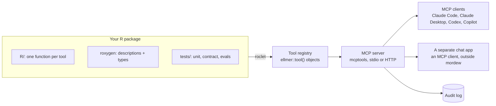
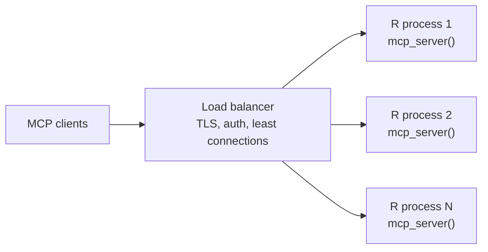
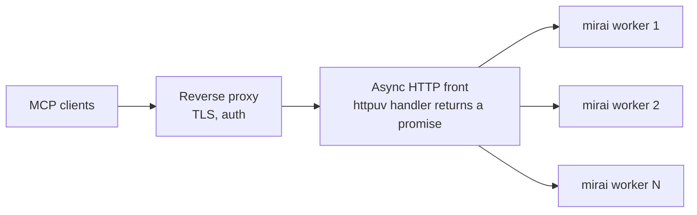

# mordew

> Build, test and ship MCP servers as R packages.

**Status: design phase.** Nothing is implemented yet. For now, this README
is the design document: it records the rationale, the target architecture,
the known pitfalls, the open questions and the full task list. Once the
package exists, it will be cut down to a user-facing README and the design
material will move to `dev/design/`.

---

## The idea in one paragraph

mordew does for MCP servers what golem does for Shiny apps: **an MCP server
is an R package**. Each tool is an exported R function, documented with
roxygen and tested with testthat. mordew scaffolds the package, turns the
roxygen documentation into an MCP tool registry, serves that registry to
any MCP client (Claude Code, Claude Desktop, Codex, Copilot…), and provides
the testing, security and deployment conventions needed to run all this in
production. mordew does not ship a chat: a chat is a separate product,
which talks to a mordew server through MCP like any other client.

Throughout this README, the examples use `runlog`, a toy package that
answers questions about a (fake) running log: distances, elevation gain,
paces, surfaces.

```r
# dev/01_start.R
mordew::create_mcp(
  path = "runlog"
)

# dev/02_dev.R: creates R/tool_summarise_runs.R and its test file
mordew::add_tool(
  name = "summarise_runs"
)

# try the tools with a model, from the R console
mordew::run_dev()

# run the MCP server (stdio by default)
runlog::run_mcp_server()
```

---

## Why

### MCP is now the standard plug

The Model Context Protocol (MCP) is the standard way to give an AI
assistant access to tools and data. Claude, ChatGPT and Copilot all
speak it.

### Validated functions instead of generated code

For data teams, the question is no longer "do we need a chat?" but "what
can the model do with our data?". Letting a model write and run arbitrary
code is powerful, but it is hard to control, to reproduce and to audit.

The alternative is to expose a **closed set of validated R functions**. The
model chooses which function to call and with which arguments; R does the
computation. Results are reproducible, tested and traceable, which is what
regulated organisations (pharma, public research) need.

This pattern is already emerging. In November 2026, Jumping Rivers
published [an agent that answers questions on clinical-trial safety
data](https://www.r-bloggers.com/2026/11/agents-in-production-build-an-ai-chat-app-with-shiny-and-shinychat/)
with four tools, where R does the counting.

### Why a framework, given that the pieces exist

Every building block already exists in R (see [Prior art](#prior-art)).
What is missing is the assembly: a convention to structure, test, secure
and deploy an MCP server as a production artefact. That is the gap golem
filled for Shiny: Shiny, testthat, roxygen and Docker all existed before
golem, and golem's contribution was "an app is a package", plus the
conventions and the path to production.

---

## What mordew is, and what it is not

mordew **is**:

- an opinionated framework where one MCP server is one R package
- scaffolding: `create_mcp()`, `add_tool()`, `dev/` scripts
- a roxygen roclet that turns documentation into a tool registry
- a testing toolkit covering three levels: unit, contract, behaviour
- runtime helpers: MCP server, asynchronous execution, audit log, limits
- deployment helpers: Docker, Kubernetes, Posit Connect

mordew **is not**:

- a new implementation of the MCP protocol: that is delegated to
  [mcptools](https://posit-dev.github.io/mcptools/)
- an LLM client: mordew never calls a model itself, except in behavioural
  evals, which rely on [ellmer](https://ellmer.tidyverse.org/) and vitals
- a chat: a chat is a separate product, an MCP client like any other
  (see [Scope: the chat is a separate product](#scope-the-chat-is-a-separate-product))
- a sandbox: OS-level isolation is documented and scaffolded, not reinvented

### Scope: the chat is a separate product

A chat that talks MCP does not depend on the server it connects to: it
works with any MCP server, written in R or not. Its concerns are those of
another product (user authentication, conversation history, choice of
model, safe rendering, scaling Shiny sessions), and its dependencies
(shiny, shinychat, ellmer) would weigh on every package built with
mordew. So mordew stops at the MCP server.

- **To try tools during development**: `mordew::run_dev()` opens an
  ellmer chat in the R console, connected to the package's MCP server
  (see [Development loop](#development-loop-run_dev)). Tools can also be
  called without a model with `call_tool()`, or tried from an MCP
  inspector or a [Claude Code session restricted to the
  server](#a-claude-code-session-restricted-to-the-server).
- **To give users a chat**: build it as its own application, for example
  a golem app using shinychat and ellmer, that connects to the mordew
  server through MCP. Everything the server enforces (validation, limits,
  asynchronous execution, audit log) then applies to the chat too. The
  section [Clients we build ourselves](#clients-we-build-ourselves) lists
  what such a chat must get right.

---

## Prior art

| Project | What it does | Gap mordew addresses |
| --- | --- | --- |
| [mcptools](https://posit-dev.github.io/mcptools/) (Posit) | MCP server from arbitrary R functions (ellmer tools), stdio or HTTP. MCP client for ellmer chats. Turnkey deployment documented for Posit Connect. | No project structure, no testing conventions, no deployment path outside Connect. |
| [mcpr](https://github.com/devOpifex/mcpr) (devOpifex) | Roxygen roclet: `@mcp` and `@type` tags generate `inst/mcp_server.R`. Tools, resources and prompts. | Generates a file, not a project framework. |
| [mcpr](https://chi2labs.github.io/mcpr/index.html) (chi2labs) | Decorator-based MCP server, following plumber's patterns. | No package structure. |
| [plumber2mcp](https://cdn.jsdelivr.net/gh/armish/plumber2mcp@main/README.md) | Turns a plumber API into an MCP server. | Starts from an API, not from a domain package. |
| [mcplite](https://stat.ethz.ch/CRAN/web/packages/mcplite/mcplite.pdf) | Lightweight stdio MCP server, with OpenTelemetry spans. | stdio only, no production framework. |
| [shinychat](https://opensource.posit.co/blog/2025-11-20_shinychat-tool-ui/) + ellmer (Posit) | Shiny chat UI wired to a model, with tool-call display. | A building block for a separate chat product, outside mordew's scope. |
| [btw](https://posit-dev.github.io/btw/) (Posit) | Ready-made tools that give models context about R sessions and packages. | Aimed at coding assistants, not at domain tools. |
| [FastMCP](https://gofastmcp.com/docs) (Python) | The reference framework in Python: schema, validation, authentication, deployment. | No R equivalent. |

The Python side carries two lessons:

1. **The framework layer has value even when the SDK exists.** According
   to [its README](https://raw.githubusercontent.com/jlowin/fastmcp/HEAD/README.md),
   some version of FastMCP powers 70% of MCP servers, all languages
   combined.
2. **Frameworks get absorbed.** FastMCP 1.0 was merged into the official
   MCP Python SDK in 2024. Posit could do the same in R, so mordew must
   build *on top of* mcptools, not against it.

---

## What makes mordew different

mordew does not try to be an MCP client: Claude, ChatGPT and Copilot
already do that well. It focuses on **industrialisation**: the model only
ever reaches R functions that are documented, typed and tested like any
package code, and the same package carries everything needed to deploy
them.

| mordew brings | Why it matters | Covered elsewhere in R? |
| --- | --- | --- |
| **Package convention**: `create_mcp()`, `add_tool()`, `dev/` scripts | An MCP server is developed, versioned, reviewed and installed like any package. | No |
| **Three-level testing**: the function, the MCP contract, the model's behaviour | Proves that the tool computes correctly, is exposed correctly, and is called correctly. | Level 1 only |
| **Production without Posit Connect**: Dockerfile, Kubernetes, auth, multi-user, asynchronous execution | Production R often runs in containers, outside Posit Connect, and must serve several users at once. | No, it has to be done by hand |
| **Audit log** of every tool call | Traceability is required in regulated environments. | No |
| **Return conventions**: data frame → table, plot → image, errors the model can act on | Keeps the model's context small and answers usable. | No |
| **Restricted client configurations** (`mcp_client_config()`) | Generates the most restricted setup each client allows, and says when it is only partial. | No |

---

## Architecture



The **tool registry** is the centre of the design. It is generated once
from roxygen and served through a single MCP server to every client. A
chat application is one of those clients, built and deployed separately.

### Anatomy of a mordew package

```
runlog/
├── DESCRIPTION
├── NAMESPACE
├── data/
│   └── runs.rda                 # fake running log used by the tools
├── R/
│   ├── tool_summarise_runs.R    # one file per tool
│   ├── run.R                    # run_mcp_server()
│   └── mordew_registry.R        # generated by the roclet, do not edit
├── inst/
│   └── mordew/
│       └── config.yml           # transport, port, workers, limits, audit log
├── tests/
│   └── testthat/
│       ├── test-tool_summarise_runs.R
│       └── test-contract.R      # schema snapshots, round-trips
├── evals/                       # behavioural evals, not run on CRAN
├── dev/
│   ├── 01_start.R
│   ├── 02_dev.R
│   └── 03_deploy.R
└── Dockerfile
```

### Writing a tool

A tool is a regular exported function. Its roxygen block is both the R
documentation and the MCP definition.

```r
#' Summarise runs by surface
#'
#' Returns the number of runs, total distance (km), total elevation gain (m)
#' and average pace (min/km) for one surface and one year.
#' Use it when the user asks about training volume or progress over a year.
#' Do not use it for questions about a single run.
#'
#' @param surface Running surface: "road", "trail" or "track".
#' @param year Four-digit year.
#'
#' @mcp_tool
#' @mcp_type surface enum road,trail,track
#' @mcp_type year integer min=2015
#' @mcp_returns table
#' @mcp_read_only
#' @export
summarise_runs <- function(
  surface,
  year
) {
  # validated computation on the runs dataset lives here
}
```

Draft tag specification:

| Tag | Role |
| --- | --- |
| `@mcp_tool [name]` | Exposes the function as a tool, optionally under another name. |
| `@mcp_type <param> <type> [constraints]` | JSON Schema type of a parameter: `string`, `integer`, `number`, `boolean`, `array`, `object`, `enum`, with constraints (`min`, `max`, `pattern`, values). |
| `@mcp_returns <kind>` | `text`, `table`, `image` or `json`; drives serialisation. |
| `@mcp_read_only`, `@mcp_destructive`, `@mcp_idempotent` | Map to MCP tool annotations (hints for clients). |
| `@mcp_limit <what> <n>` | Per-tool limits: rows returned, seconds of execution. |

The title and description become the tool description, and each `@param`
becomes a parameter description. **These texts are prompts**: they should
say when to use the tool, when not to, and give units and formats.
mordew will ship a guide on writing them.

### Return conventions

| R value | Sent to the model as |
| --- | --- |
| `character` | text content |
| `data.frame` | markdown table, truncated to `max_rows`, with dimensions and a short summary |
| `ggplot` or recorded plot | PNG image content |
| `list` | JSON |
| condition (error) | an `isError` result with a message the model can act on |
| very large outputs | to explore: an MCP resource instead of inline content |

### Runtime and process model

- **The server owns its process.** `mcptools::mcp_server()` blocks the R
  process that calls it, so `run_mcp_server()` is meant to be the main
  loop of a dedicated process, never something run inside another app.
- **Transports.** With stdio, each desktop client spawns its own R
  process: one user, no auth. With HTTP, one shared server serves many
  users, so it needs authentication and a concurrency strategy.
- **Concurrency.** R is single-threaded, and `mcptools::mcp_server()`
  runs one tool call at a time (see below). **Asynchronous execution is a
  hard requirement for production**: a server that blocks on every call
  cannot serve several users. See [Scaling an HTTP
  deployment](#scaling-an-http-deployment).
- **State.** Tools must be stateless by default, so that any process can
  answer any call. When a multi-step analysis (load, filter, model) needs
  state, it lives outside the R process (database, Redis, files), behind
  handles (`"dataset_1"`) with a time-to-live, isolated per session.
- **Configuration.** golem-style `inst/mordew/config.yml`: transport,
  port, worker pool, limits, audit log location. The model and the
  system prompt belong to the client, not to the server.
- **Observability.** OpenTelemetry tracing of each tool call, building on
  the instrumentation already present in ellmer and mcplite.

### What mcptools does today

Checked in the mcptools source (development version 1.0.3.9000), because
mordew's runtime design depends on it:

- **Tool execution is synchronous.** Over HTTP, `mcp_server(type = "http")`
  starts an httpuv server and runs `httpuv::service(Inf)`. The request
  handler calls the tool directly (`do.call(data$tool, args)`) and returns
  the response; it never returns a promise. A tool that takes 30 seconds
  blocks every other request, from every client, for 30 seconds.
- **stdio reads asynchronously but processes sequentially.** Reading stdin
  uses `nanonext::recv_aio()`, but calls are handled one after the other.
  That is fine: a stdio process serves a single client.
- **The HTTP server is stateless.** It never issues an `Mcp-Session-Id`,
  and the protocol version travels with each message. Any process can
  answer any request, so no sticky sessions are needed.
- **No streaming.** GET and SSE are refused (HTTP 405); only POST is
  handled. The `ping` method is not implemented.
- **`mcp_session()` has no queue of its own.** It keeps one pending
  `recv_aio()` wrapped in a promise. The callback runs through the `later`
  event loop, that is only when the interactive session is idle, then
  executes the tool synchronously. On the other side, the server forwards
  one request at a time and blocks until the answer comes back or a
  timeout expires (120 seconds by default, set with the
  `mcptools.session_response_timeout_seconds` option or the
  `MCPTOOLS_SESSION_RESPONSE_TIMEOUT_SECONDS` variable). `mcp_session()` is
  a development tool, not a deployment target.
- **Access checks are minimal.** An optional shared secret
  (`Plumber-Shared-Secret` header), an optional list of trusted hosts
  (`MCPTOOLS_HTTP_TRUSTED_HOSTS`), and an `Origin` check that only lets
  localhost through unless `MCPTOOLS_HTTP_ALLOWED_ORIGINS` is set. Real
  authentication belongs in front of the server.

The MCP specification goes the same way: in its [2026-07-28
revision](https://modelcontextprotocol.io/specification/2026-07-28/basic/transports),
Streamable HTTP sends each message as a POST to a single endpoint, and
every request carries its protocol version and client capabilities. With
no handshake and no session, any instance can serve any request, which is
what horizontal scaling needs.

### Connecting external clients

Claude Code:

```bash
claude mcp add runlog -- Rscript -e "runlog::run_mcp_server()"
```

Claude Desktop (`claude_desktop_config.json`):

```json
{
  "mcpServers": {
    "runlog": {
      "command": "Rscript",
      "args": ["-e", "runlog::run_mcp_server()"]
    }
  }
}
```

mordew will generate these snippets with a helper such as
`mcp_client_config()`.

### A Claude Code session restricted to the server

Claude Code has no `--mcp-only` flag, but four flags give the same result,
and this time it is enforced, not just requested:

```bash
claude \
  --tools "" \
  --strict-mcp-config \
  --mcp-config ./runlog.json \
  --allowedTools "mcp__runlog__*"
```

where `runlog.json` holds the Claude Desktop snippet above.

| Flag | Effect |
| --- | --- |
| `--tools ""` | Removes every built-in tool (Bash, Read, Edit, web access…). MCP tools are not affected. |
| `--strict-mcp-config` | Loads only the servers passed with `--mcp-config`, ignoring `.mcp.json`, user configuration and other MCP sources. |
| `--mcp-config ./runlog.json` | Loads the mordew server. |
| `--allowedTools "mcp__runlog__*"` | Approves the server's tools without prompting. It only changes permissions: it removes nothing. |

`--disable-slash-commands` also turns off skills and slash commands. In
such a session, the model cannot run shell commands or read files: those
tools simply do not exist. One caveat: when an organisation deploys a
managed `managed-mcp.json`, Claude Code exits at startup if
`--strict-mcp-config` is passed. See the [CLI
reference](https://code.claude.com/docs/en/cli-reference) and the [MCP
documentation](https://code.claude.com/docs/en/mcp).

`mcp_client_config()` will generate this command too.

### Restricting other MCP clients

Claude Code is the only client found so far with a documented,
all-or-nothing switch for built-in tools. Elsewhere, restriction goes
through configuration, is partial, and is sometimes explicitly described
as not being a security mechanism. Checked in November 2026:

| Client | Remove built-in tools | Restrict MCP servers and tools | How far it goes |
| --- | --- | --- | --- |
| [Claude Code](https://code.claude.com/docs/en/cli-reference) | `--tools ""` removes every built-in tool | `--strict-mcp-config` + `--mcp-config`; `--disallowedTools` | Enforced: the tools are not in the session. |
| [Codex CLI](https://github.com/openai/codex/issues/6049) | `features.shell_tool = false` (or `codex --disable shell_tool`). Other features (`multi_agent`, `view_image`, `web_search = "disabled"`…) can be turned off one by one. | `mcp_servers.<id>.enabled_tools` and `disabled_tools` | Partial: no official MCP-only mode (the request is still open). Three MCP resource tools (`list_mcp_resources`, `list_mcp_resource_templates`, `read_mcp_resource`) cannot be disabled; they only read MCP resources. |
| [Gemini CLI](https://geminicli.com/docs/cli/configuration) | `coreTools` (allowlist) or `excludeTools`, tool by tool; no documented "none" option | `allowMCPServers` or `--allowed-mcp-server-names`; per-server `includeTools` and `excludeTools` | Partial: the documentation says these lists should not be used as an airtight security mechanism. |
| [VS Code, Copilot](https://code.visualstudio.com/docs/agent-customization/tools) | Tool picker per request; a custom agent with its own tool list for a reusable selection | Same picker, per server and per tool; enterprise allowlist of MCP servers | Per session or per agent, configured in the editor. |

Two consequences for mordew:

1. **The server is the security boundary, not the client.** Whatever the
   client, the closed tool list, argument validation, limits and
   OS-level isolation described in the [security model](#security-model)
   must hold on their own.
2. **`mcp_client_config()` generates the most restricted configuration
   each client allows**, and says plainly when that restriction is
   partial.

### Development loop: `run_dev()`

mordew ships no chat, but it gives a quick way to talk to the package's
tools while developing them, the way `golem::run_dev()` runs a Shiny app
under development. Two clients are planned:

```r
# any model provider, through ellmer (needs an API key)
mordew::run_dev(
  client = "ellmer",
  chat = ellmer::chat_anthropic(),
  ui = "console"
)

# the `claude` CLI found on the PATH (uses the Claude subscription)
mordew::run_dev(
  client = "claude"
)
```

In both cases, `run_dev()` first writes a temporary MCP configuration
whose stdio server starts the development version of the package
(`Rscript -e "pkgload::load_all(quiet = TRUE); run_mcp_server()"`). Then:

| | `client = "ellmer"` | `client = "claude"` |
| --- | --- | --- |
| Connects to the server with | `mcptools::mcp_tools()`, then `chat$set_tools()` | `--mcp-config` pointing to the temporary configuration |
| Opens | `ellmer::live_console()`, or `ellmer::live_browser()` with `ui = "browser"` | a Claude Code session in the IDE terminal (RStudio, Positron), or prints the command to paste |
| Model and billing | any ellmer provider or a local model; API key in the environment, billed per token | the user's Claude Code login, for example a Claude subscription |
| Other tools available | none: ellmer only sends the server's tools | none: the session is [restricted to the server](#a-claude-code-session-restricted-to-the-server) |

With `client = "claude"`, the command `run_dev()` runs is:

```bash
claude --tools "" --strict-mcp-config \
  --mcp-config /tmp/runlog-mcp.json \
  --allowedTools "mcp__runlog__*"
```

Claude Code is a full-screen terminal interface, so it cannot run inside
the R console itself. For a one-off question from R,
`claude -p "question" --output-format json`, with the same flags, returns
the answer and the tool calls, which can also feed quick evals.

ellmer itself has no provider that drives the `claude` CLI: its Anthropic
provider calls the API. Third-party packages that reuse a Claude
subscription's OAuth tokens outside Claude Code are not an option for
mordew: they are fragile, and their use has to be checked against
Anthropic's terms.

The tools go through MCP, exactly as they will for any other client:
same schema, same validation, same serialisation. Each tool call is
shown with its arguments, so it is clear at once whether the model picks
the right tool.

Things to keep in mind:

- The server runs in its own process: changing a tool means restarting
  `run_dev()`.
- In stdio mode, nothing but protocol messages may reach stdout. Package
  loading must stay quiet, and tools must not `cat()` or `print()`.
- `run_dev()` is a manual version of the level 3 tests: evals automate
  the same loop over a set of questions.

---

## Testing strategy

Testing is at the core of mordew. There are three levels, plus
security tests.

| Level | Question answered | Tooling | Where it runs |
| --- | --- | --- | --- |
| 1. Unit | Does the function compute the right result? | testthat | `R CMD check`, CI |
| 2. Contract | Is the tool exposed correctly over MCP? | mordew helpers + testthat snapshots | `R CMD check`, CI |
| 3. Behaviour | Does the model pick the right tool with the right arguments? | evals with vitals | separate CI job, before releases |
| Security | Does the tool resist hostile arguments? | mordew helpers | `R CMD check`, CI |

**Level 2, the contract**, is the one nobody covers today. It checks that:

- every parameter is documented and typed, and every typed parameter exists
- the generated JSON schema matches a snapshot, so that any change to a
  tool's interface shows up in review as a breaking change
- return values serialise to valid MCP content
- errors come back as `isError` results, not as crashes
- a full round-trip works through a real MCP client over stdio

```r
test_that(
  "summarise_runs is exposed with a stable schema",
  {
    expect_tool_schema(
      tool = "summarise_runs"
    )
  }
)

test_that(
  "summarise_runs answers through a real MCP client",
  {
    res <- call_tool(
      tool = "summarise_runs",
      args = list(
        surface = "trail",
        year = 2025
      ),
      transport = "stdio"
    )
    expect_false(
      res$isError
    )
  }
)
```

**Level 3, behaviour**, uses evals: each case is a user prompt with the
expected tool and arguments, scored over several runs. Evals need an API
key, cost money and are not deterministic, so they run in a separate CI
job with pass thresholds, before releases and whenever a tool description,
the system prompt or the model changes.

**Security tests** feed hostile arguments to each tool: injection strings,
huge values, wrong types, paths outside the allowed scope.

Planned helpers: `expect_tool_schema()`, `call_tool()`,
`expect_tool_error()`, `use_evals()`, `check_tools()`.

---

## Security model

### Principles

1. **The tool list is the security boundary, not R.** The model can only
   call what the server exposes, but anything a tool can do, the model
   can trigger.
2. **Arguments are untrusted input.** The model generates them, and the
   content it reads (data, documents, web pages) can steer it through
   prompt injection.
3. **Everything a tool returns leaves your infrastructure.** The model
   provider reads every result, unless the model is self-hosted.
4. **Instructions are not enforcement.** Telling a client "only use this
   MCP server" is a preference the model usually follows, not a guarantee.
   Only the tools actually available to it are enforced. In a default
   Claude Desktop or Claude Code setup, a mordew server sits next to
   other connectors and built-in tools that we do not control. Only two
   setups control the full tool list: a client we build ourselves (see
   [Clients we build ourselves](#clients-we-build-ourselves)), and a
   [Claude Code session restricted to the
   server](#a-claude-code-session-restricted-to-the-server).

[Posit warns](https://tidyverse.org/blog/2025/07/mcptools-0-1-0/) that
mixing MCP servers can create the "lethal trifecta": access to private
data, exposure to untrusted content, and a way to send data out. A
mordew server holds the first one by design, so the other two must be
kept away.

### Controls

| Risk | Control |
| --- | --- |
| Arbitrary code execution | No free-form "run R code" tool. `check_tools()` statically flags `eval(parse())`, `system()`, `source()` and similar calls in tool code. |
| Malformed or hostile arguments | Validation generated from the schema, before the function runs. |
| R can still reach the system | OS-level isolation in production: non-root container, read-only file system, restricted network egress. On Linux, per-call sandboxing with `unix::eval_safe()` or [RAppArmor](https://cran.r-project.org/web/packages/RAppArmor/index.html). |
| Runaway calls | Per-call timeouts and resource limits. |
| Data leakage to the model provider | Aggregated outputs by default, `max_rows`, a redaction hook, and, on the client side, the option of a self-hosted model. |
| Unauthorised access to an HTTP server | Authentication following the MCP authorization specification (OAuth 2.1), or a reverse proxy in front of the server. |
| No traceability | Audit log of every call (below). |
| Secrets exposed to the model | Secrets come from environment variables or config, never from tool arguments or results. |

### Clients we build ourselves

A chat is outside mordew's scope, but whoever builds one on top of a
mordew server needs to know why it differs from third-party clients, and
where it can still leak.

In Claude Code or Codex, we configure someone else's product, which ships
its own tools and reads other configuration sources: we can only remove
what its vendor lets us remove. In a chat we build, **we are the
client**. Our code (for example ellmer) calls the model API and sets the
tool list sent with every request:

- A model called through an API has no tools by default: no shell, no
  files. It can only request the tools declared in the request, here the
  mordew registry.
- Tools run in the client's code. A tool the model invents has no
  function behind it.
- Tools hosted by the model provider (web search, code execution) are
  only enabled if the request asks for them.
- Users cannot add connectors or MCP servers, and the system prompt is
  ours.

Three risks remain:

1. Tool results still go to the model provider.
2. Prompt injection through the data can still make the model misuse our
   own tools, hence argument validation and limits on the server side.
3. **The chat UI itself can leak data.** If it renders Markdown images, an
   injected instruction can make the model write an image whose URL
   carries data (``), and the browser
   sends it when loading the image. Such a chat must not load remote
   images or other remote resources from model output: render
   images as plain links or drop them, and set a Content Security Policy
   that only allows the app's own origin.

### Audit log

One JSON line per tool call, append-only: timestamp, session ID, user
(when authenticated), client, tool, arguments, result size and hash,
duration and status. Storing full results is optional because it is a
privacy trade-off.

---

## Deployment

| Target | Transport | How |
| --- | --- | --- |
| Local, desktop client | stdio | `Rscript -e "pkg::run_mcp_server()"`, snippet from `mcp_client_config()` |
| Docker | HTTP | `add_dockerfile()`, built on [dockerfiler](https://github.com/ThinkR-open/dockerfiler) as in golem |
| Kubernetes | HTTP | example manifests: probes, replicas, secrets |
| Posit Connect | HTTP | mcptools' `_server.yml` with `engine: mcptools`, through `add_connect()` |

### When a single process is enough

- **stdio**: never needs scaling. Each client spawns its own R process.
- **HTTP for one user, or with fast tools and little traffic**: one
  process is enough, as long as calls stay well under the timeouts.

Everything else, meaning several users at the same time or tools that
take seconds, needs asynchronous execution.

### Scaling an HTTP deployment

Because one `mcp_server()` process runs one call at a time, there are two
ways to serve concurrent calls. mordew must support both.

**A. Replicas behind a load balancer.** N identical R processes or
containers, behind nginx, Traefik or a Kubernetes Service. It needs no
change to the server, since the HTTP transport is stateless. The cost is
memory: each replica loads its own copy of the data.



**B. One asynchronous front, a pool of workers.** A single HTTP process
whose handler returns a promise instead of blocking, while tools run in a
pool of mirai daemons. The front keeps accepting requests while tools
compute; data can be loaded once per worker; there is a single container
to deploy. mcptools cannot do this today because `execute_tool_call()` is
synchronous, so mordew has to wrap it, or contribute the change upstream.



**A + B.** Several replicas, each with its own worker pool, for large
deployments.

### Asynchronous execution: production requirements

- Non-blocking handler: the HTTP front never runs a tool itself.
- A configurable worker pool (size, memory, data loaded at start-up).
- A timeout per call, after which the worker is stopped and recycled, and
  the client receives an error result instead of a hanging request.
- Back-pressure: a bounded queue, and a clear "busy, retry later" error
  when it is full, rather than unbounded waiting.
- Cancellation: when a client gives up, the call stops, if the
  specification revision in use allows it.
- Progress feedback for long calls, if the specification revision in use
  allows it, so that users are not left in front of a frozen client.
- Every call stays in the audit log with its queue time, run time and
  status.

### Load balancer checklist

- **Algorithm**: least connections rather than round-robin, because call
  durations vary widely and each process (or worker) runs one call at a
  time.
- **Health check**: mcptools answers GET with HTTP 405 and does not
  implement `ping`. Either accept 405, use a TCP check, or POST a
  `tools/list` request. mordew should add a dedicated health endpoint.
- **Timeouts**: align the proxy timeouts with the longest tool. nginx's
  `proxy_read_timeout` defaults to 60 seconds; a longer tool ends in a 504.
- **Host and Origin**: if `MCPTOOLS_HTTP_TRUSTED_HOSTS` is set, the proxy
  must forward the original `Host` header. Clients that send a non-local
  `Origin` get a 403 unless `MCPTOOLS_HTTP_ALLOWED_ORIGINS` lists it.
- **Authentication and TLS**: at the proxy (OAuth or OIDC). The optional
  shared secret of mcptools is not user authentication.
- **No sticky sessions**, as long as tools keep no state in memory.

### Containers

`add_dockerfile()` builds on
[dockerfiler](https://github.com/ThinkR-open/dockerfiler)
(`dock_from_desc()`, `dock_from_renv()`), the same way golem does. The
generated Dockerfile:

- starts from `rocker/r-ver`, pinned to the R version of `renv.lock`
- installs the system dependencies computed from the package dependencies
- restores the R dependencies with renv, then installs the package
- runs as a non-root user
- exposes the port and starts the server on `0.0.0.0`

Sketch of what it could generate for `runlog`:

```dockerfile
# R version taken from renv.lock
ARG R_VERSION
FROM rocker/r-ver:${R_VERSION}

# system dependencies computed from the package dependencies
RUN apt-get update \
    && apt-get install -y --no-install-recommends curl libcurl4-openssl-dev libssl-dev \
    && rm -rf /var/lib/apt/lists/*

# reproducible R dependencies
COPY renv.lock /tmp/renv.lock
RUN R -e "install.packages('renv'); renv::restore(lockfile = '/tmp/renv.lock')"

# the package itself
COPY runlog_*.tar.gz /tmp/
RUN R CMD INSTALL /tmp/runlog_*.tar.gz

# never run as root
RUN useradd --create-home mordew
USER mordew

EXPOSE 8080
# dedicated health endpoint, planned in mordew
HEALTHCHECK CMD curl -fsS http://127.0.0.1:8080/health || exit 1
CMD ["Rscript", "-e", "runlog::run_mcp_server(transport = 'http', host = '0.0.0.0', port = 8080)"]
```

**Image variants.** The function arguments below are a planned API.

| Image | Transport | Starts | For |
| --- | --- | --- | --- |
| MCP server, replica | HTTP | `run_mcp_server(transport = "http", host = "0.0.0.0")` | architecture A, behind a load balancer |
| MCP server, worker pool | HTTP | `run_mcp_server(transport = "http", host = "0.0.0.0", workers = 4)` | architecture B, one container |
| stdio | stdio | `run_mcp_server()` | desktop clients, through `docker run -i --rm` |

**stdio in Docker.** An MCP client can start a container instead of a
local R process. This ships an R-based MCP server to people who do not
have R installed:

```json
{
  "mcpServers": {
    "runlog": {
      "command": "docker",
      "args": ["run", "-i", "--rm", "runlog"]
    }
  }
}
```

**docker-compose.** A generated `docker-compose.yml` runs the MCP server
(replicas or worker pool) and a reverse proxy together, to test the whole
architecture locally before deploying it.

### Container checklist

- **Bind to `0.0.0.0`.** `mcptools::mcp_server()` listens on `127.0.0.1`
  by default, which makes the server unreachable from outside the
  container.
- **Non-root user**, read-only root file system, only temporary
  directories writable.
- **Health check** on a dedicated endpoint (see the load balancer
  checklist).
- **Secrets and model API keys** come from environment variables or a
  secret store, never baked into the image.
- **Configuration** through environment variables that override
  `inst/mordew/config.yml`.
- **stdout is reserved for the protocol in stdio mode.** Any `cat()`,
  `print()` or message written to stdout by a tool corrupts the JSON-RPC
  stream; logs go to stderr or to a file.
- **Pinned versions**: R version, `renv.lock`, base image digest.
- **Resource limits** (CPU, memory) per container, sized to the worker
  pool.
- **Restricted network egress**, as described in the security model.

---

## Relationship with golem

- Same philosophy: a package, `dev/` scripts, conventions over configuration.
- Same tooling where possible: dockerfiler, attachment, config.
- Possible bridges, to explore: a chat built as a golem app that connects
  to mordew servers through MCP, or a `golem::add_mcp()` exposing an app's
  business logic as an MCP server.

---

## Roadmap and task list

The plan is to **build for real use cases first, then extract the
framework** from what repeats, the same way golem came out of real-world
Shiny projects.

### Phase 0: frame and validate

- [ ] Collect two or three real use cases (which functions, which data) to drive the design
- [ ] Check the name: `available::available("mordew")` (CRAN, Bioconductor, GitHub, meanings)
- [ ] Choose the licence
- [ ] Read the mcptools internals: registry format, HTTP server, session tools, client side
- [ ] Compare mcptools and mcplite as the protocol layer
- [ ] Get in touch with the mcptools maintainers to align and avoid duplicated work

### Phase 1: prototype without the framework

- [ ] Build one real-world MCP server by hand with mcptools, used from existing MCP clients
- [ ] Write down every repetition and every point of friction
- [ ] Measure tool-call accuracy, latency and token usage
- [ ] Collect security and compliance requirements from regulated users

### Phase 2: core framework (MVP)

- [ ] Set up the mordew package: DESCRIPTION, testthat 3rd edition, lintr, GitHub Actions `R-CMD-check`, pkgdown
- [ ] `create_mcp()`: package template, `dev/` scripts, `inst/mordew/config.yml`
- [ ] `add_tool()`: tool file and test file from templates
- [ ] Specify the roxygen tags (`@mcp_tool`, `@mcp_type`, `@mcp_returns`, annotations, limits)
- [ ] Write the roclet that generates `R/mordew_registry.R`
- [ ] Argument validation generated from the schema
- [ ] Return-value serialisation (text, table, image, JSON, errors)
- [ ] `run_mcp_server()` for stdio and HTTP, on top of mcptools
- [ ] Spike: asynchronous HTTP front (handler returning a promise, tools in mirai workers) to validate architecture B early
- [ ] `run_dev(client = "ellmer")`: ellmer chat (console or ellmer's browser UI) connected to the development version of the package through MCP
- [ ] `run_dev(client = "claude")`: restricted Claude Code session from the `claude` CLI on the PATH, opened in the IDE terminal or printed
- [ ] Document the other ways to try tools: `call_tool()`, an MCP inspector, a restricted Claude Code session
- [ ] `mcp_client_config()` for Claude Desktop, Claude Code, Codex CLI, Gemini CLI and VS Code: the most restricted configuration each client allows, with a warning when the restriction is partial
- [ ] Re-check client restriction options before each release: they change quickly

### Phase 3: testing toolkit

- [ ] `call_tool()`: call a tool with JSON arguments, the way a client does
- [ ] `expect_tool_schema()`: schema snapshot
- [ ] `expect_tool_error()`: errors come back as `isError`
- [ ] Round-trip helper through a real MCP client over stdio
- [ ] `use_evals()`: vitals scaffolding and a separate CI workflow
- [ ] `check_tools()`: static analysis of tool code
- [ ] Hostile-argument test generator

### Phase 4: production

- [ ] Asynchronous execution: non-blocking HTTP front and a mirai worker pool (architecture B)
- [ ] Worker pool configuration: size, memory, data loaded at start-up
- [ ] Per-call timeouts with worker recycling, and resource limits
- [ ] Back-pressure: bounded queue and a "busy, retry later" error
- [ ] Cancellation and progress feedback, depending on the specification revision
- [ ] Dedicated health endpoint for load balancers and Kubernetes probes
- [ ] Deployment guide for replicas behind a load balancer (architecture A), with nginx and Kubernetes examples
- [ ] Load tests: concurrent users, slow tools, timeouts, queue saturation
- [ ] Check that tools keep no in-memory state (a contract test)
- [ ] `add_dockerfile()` with dockerfiler: HTTP replica, worker pool and stdio variants
- [ ] Generated `docker-compose.yml`: MCP server and reverse proxy
- [ ] Container defaults: `0.0.0.0` binding, non-root user, health check, configuration through environment variables
- [ ] Authentication for the HTTP transport
- [ ] Audit log, with queue time and run time
- [ ] Session-scoped object store, if the prototype shows it is needed
- [ ] OpenTelemetry tracing
- [ ] Kubernetes manifests example
- [ ] `add_connect()` for Posit Connect
- [ ] Redaction hook and output policies

### Phase 5: documentation and launch

- [ ] Vignettes: getting started, writing tool descriptions, testing, security, deployment
- [ ] pkgdown site
- [ ] `runlog`, a demo package built with mordew on a fake running log (distance, elevation gain, pace, surface)
- [ ] Hex sticker
- [ ] Blog post and conference talk

---

## Open questions

1. **Generated code or runtime introspection?** Generating
   `R/mordew_registry.R` (as mcpr does) is inspectable and reviewable.
   Building the registry at runtime from the Rd files is simpler but less
   visible.
2. **Explicit type tags or inference?** Tags are explicit but verbose.
   Types could also be inferred from defaults or from assertions
   (checkmate, rlang).
3. ~~**Should the embedded chat go through MCP or call tools
   directly?**~~ Decided: mordew ships no chat. A chat is a separate
   product and talks to a mordew server through MCP, like any client.
4. **Which protocol layer?** mcptools (maintained by Posit, HTTP, Connect)
   or mcplite (lightweight, OpenTelemetry).
5. **State model**: stateless only, or handles with a session object store.
6. **Package split**: one package, or `mordew` plus a separate testing
   package.
7. **Licence**.
8. **Bridges with golem**.
9. **Asynchronous execution: in mordew or upstream?** Wrap mcptools'
   synchronous `execute_tool_call()` inside mordew, or propose a
   promise-based handler to mcptools.
10. **Default architecture for HTTP**: replicas (A), worker pool (B), or
    both by default.
11. **Should a generated package depend on mordew at runtime?** Two
    options:
    - *Runtime dependency* (as golem apps depend on golem): the package
      imports mordew for `run_mcp_server()`, serialisation, validation
      and the async front. Generated code stays small and benefits from
      mordew's fixes, but mordew must be on CRAN before any package built
      with it can be, and every user installs mordew's dependencies.
    - *Design-time only*: mordew lives in `Suggests` and generates
      self-contained code that only imports mcptools. Dependencies are
      lighter and the path to CRAN is easier, but generated code grows,
      and fixes require regenerating the code.

    Either way, a mordew package should pass `R CMD check --as-cran`:
    evals and `dev/` in `.Rbuildignore`, round-trip tests through a
    subprocess skipped on CRAN, examples that never start a blocking
    server, small example data.

---

## Risks

| Risk | Why it is serious | Mitigation |
| --- | --- | --- |
| Overlap with Posit's tooling | Posit maintains the whole stack (ellmer, mcptools, shinychat, Connect), and FastMCP 1.0 was absorbed into the official Python SDK. | Build on mcptools for the protocol and coordinate with its maintainers; focus on what it does not cover (project structure, testing, production outside Connect). |
| The MCP specification changes fast | [Posit describes MCP](https://tidyverse.org/blog/2025/07/mcptools-0-1-0/) as a recent and rapidly evolving framework. | Delegate the protocol to mcptools; mordew stays one layer above. |
| Maintenance cost | Open source means issues, support and upgrades. | Keep the scope small, delegate the moving parts to Posit-maintained packages, welcome contributors early. |
| Unclear adoption | Real use cases still have to be collected. | Build the prototype on real use cases before the first release. |
| Flaky, costly evals | Models are not deterministic, and every eval run costs tokens. | Thresholds, several runs per case, a separate CI job. |
| A blocking server in production | One `mcp_server()` process runs one call at a time; one slow call blocks every user. | Asynchronous execution is a production requirement: mirai worker pool (B), replicas behind a load balancer (A), timeouts and back-pressure. |

---

## About the name

Mordew is the city in Alex Pheby's novel of the same name, where God is
dead and his corpse lies in the catacombs beneath the streets, while the
Living Mud spawns half-formed, short-lived creatures. A golem is clay
brought to life by words; Mordew is mud that spawns life. In French, the
name sounds like *mordieu*, an old oath meaning "by God's death".

---

## References

- [mcptools](https://posit-dev.github.io/mcptools/) and [`mcp_server()` reference](https://posit-dev.github.io/mcptools/reference/server.html)
- [R and the Model Context Protocol](https://tidyverse.org/blog/2025/07/mcptools-0-1-0/), tidyverse blog
- [mcpr (devOpifex)](https://github.com/devOpifex/mcpr)
- [mcpr (chi2labs)](https://chi2labs.github.io/mcpr/index.html)
- [plumber2mcp](https://cdn.jsdelivr.net/gh/armish/plumber2mcp@main/README.md)
- [mcplite](https://stat.ethz.ch/CRAN/web/packages/mcplite/mcplite.pdf)
- [shinychat: tool calling UI](https://opensource.posit.co/blog/2025-11-20_shinychat-tool-ui/)
- [FastMCP documentation](https://gofastmcp.com/docs) and [README](https://raw.githubusercontent.com/jlowin/fastmcp/HEAD/README.md)
- [Agents in Production](https://www.r-bloggers.com/2026/11/agents-in-production-build-an-ai-chat-app-with-shiny-and-shinychat/), Jumping Rivers
- [RAppArmor](https://cran.r-project.org/web/packages/RAppArmor/index.html)
- [Model Context Protocol](https://modelcontextprotocol.io/)
