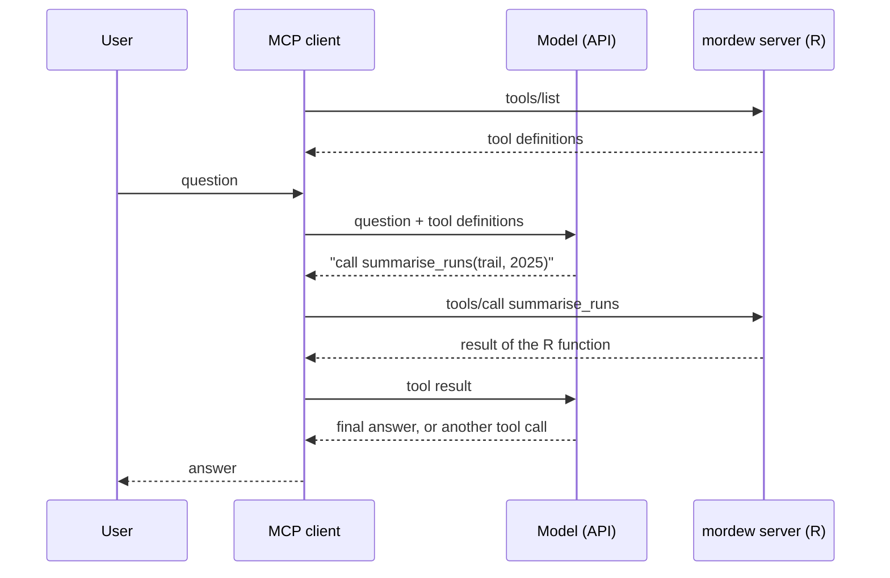
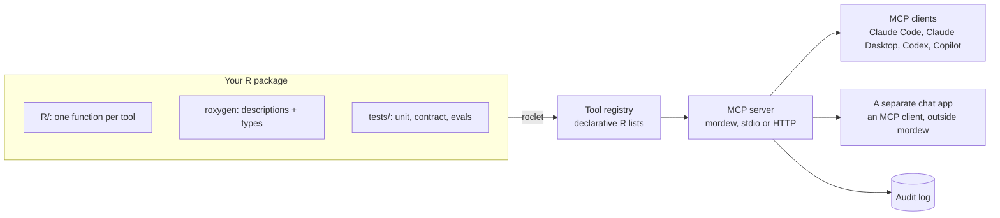
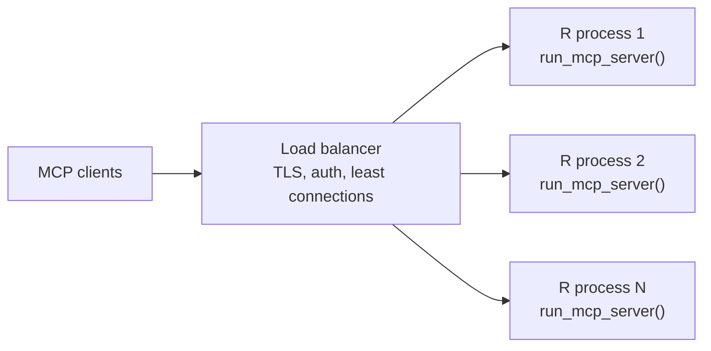
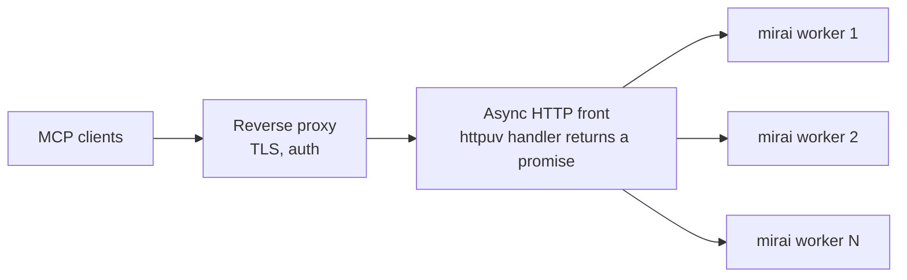

# `{mordew}`

<!-- badges: start -->

[](https://github.com/ThinkR-open/mordew/actions/workflows/R-CMD-check.yaml)

<!-- badges: end -->

> Build, test and ship MCP servers as R packages.

**Status: proof of concept**, not yet released. Tools are served over
stdio and HTTP, tested at three levels, and deploy to Docker and Posit
Connect; the [roadmap](#roadmap-and-task-list) says what is done and what
is only planned. For now, this README is also the design document: it
records the rationale, the target architecture, the known pitfalls, the
open questions and the task list. Sections describe the target design;
what is not built yet is marked as planned.

---

## The idea in one paragraph

`{mordew}` does for MCP servers what golem does for Shiny apps: **an MCP server
is an R package**. Each tool is an exported R function, documented with
roxygen and tested with testthat. `{mordew}` scaffolds the package, turns the
roxygen documentation into an MCP tool registry, serves that registry to
any MCP client (Claude Code, Claude Desktop, Codex, Copilot…), and provides
the testing, security and deployment conventions needed to run all this in
production. `{mordew}` does not ship a chat: a chat is a separate product,
which talks to a `{mordew}` server through MCP like any other client.

Throughout this README, the examples use `runlog`, a toy package that
answers questions about a (fake) running log: distances, elevation gain,
paces, surfaces.

```r
# create the package, with its dev/ scripts
mordew::create_mordew(
  path = "runlog"
)

# dev/02_dev.R: creates R/tool_summarise_runs.R and its test file
mordew::add_tool(
  name = "summarise_runs"
)

# try the tools with a model, from the R console
mordew::run_dev(
  chat = ellmer::chat_anthropic()
)

# dev/02_dev.R: creates dev/evals.R and a CI workflow that runs it
mordew::use_evals()

# run the MCP server: stdio by default, transport = "http" for several users
runlog::run_mcp_server()
```

---

## Why

### MCP is now the standard plug

The Model Context Protocol (MCP) is the standard way to give an AI
assistant access to tools and data. Claude, ChatGPT and Copilot all
speak it.

### Validated functions instead of generated code

For data teams, the question is no longer "do we need a chat?" but "what
can the model do with our data?". Letting a model write and run arbitrary
code is powerful, but it is hard to control, to reproduce and to audit.

The alternative is to expose a **closed set of validated R functions**. The
model chooses which function to call and with which arguments; R does the
computation. Results are reproducible, tested and traceable, which is what
regulated organisations (pharma, public research) need.

This pattern is already emerging. In November 2026, Jumping Rivers
published [an agent that answers questions on clinical-trial safety
data](https://www.r-bloggers.com/2026/11/agents-in-production-build-an-ai-chat-app-with-shiny-and-shinychat/)
with four tools, where R does the counting.

### Why a framework, given that the pieces exist

Every building block already exists in R (see [Prior art](#prior-art)).
What is missing is the assembly: a convention to structure, test, secure
and deploy an MCP server as a production artefact. That is the gap golem
filled for Shiny: Shiny, testthat, roxygen and Docker all existed before
golem, and golem's contribution was "an app is a package", plus the
conventions and the path to production.

---

## What `{mordew}` is, and what it is not

`{mordew}` **is**:

- an opinionated framework where one MCP server is one R package
- scaffolding: `create_mordew()`, `add_tool()`, `use_evals()`, `dev/` scripts; `add_resource()` and `add_prompt()` are planned
- tools today; the rest of the MCP specification as a direction: resources and prompts, structured output, elicitation, completion, progress, cancellation and the tasks extension
- a roxygen roclet that turns documentation into a tool registry
- a testing toolkit covering three levels: unit, contract, behaviour, plus security
- runtime helpers: its own thin MCP protocol layer, over stdio and HTTP, with a worker pool and limits; an audit log is planned
- deployment helpers: Docker and Posit Connect; Kubernetes is planned

`{mordew}` **is not**:

- an LLM client: `{mordew}` never calls a model itself, except in behavioural
  evals, which run the model through the `claude` CLI
- a chat: a chat is a separate product, an MCP client like any other
  (see [Scope: the chat is a separate product](#scope-the-chat-is-a-separate-product))
- a sandbox: OS-level isolation is documented and scaffolded, not reinvented

### Scope: the chat is a separate product

A chat that talks MCP does not depend on the server it connects to: it
works with any MCP server, written in R or not. Its concerns are those of
another product (user authentication, conversation history, choice of
model, safe rendering, scaling Shiny sessions), and its dependencies
(shiny, shinychat, ellmer) would weigh on every package built with
`{mordew}`. So `{mordew}` stops at the MCP server.

- **To try tools during development**: `mordew::run_dev()` opens an
  ellmer chat in the R console, or gives the command of a Claude Code
  session, connected to the package's MCP server (see [Development
  loop](#development-loop-run_dev)). The other ways to
  try them, with or without a model, are in [Trying the
  tools](#trying-the-tools).
- **To give users a chat**: build it as its own application, for example
  a golem app using shinychat and ellmer, that connects to the `{mordew}`
  server through MCP. Everything the server enforces (validation, limits,
  the worker pool) then applies to the chat too. The
  section [Clients we build ourselves](#clients-we-build-ourselves) lists
  what such a chat must get right.

---

## Prior art

| Project                                                                                      | What it does                                                                                                                                       | Gap `{mordew}` addresses                                                          |
| -------------------------------------------------------------------------------------------- | -------------------------------------------------------------------------------------------------------------------------------------------------- | --------------------------------------------------------------------------------- |
| [mcptools](https://posit-dev.github.io/mcptools/) (Posit)                                    | MCP server from arbitrary R functions (ellmer tools), stdio or HTTP. MCP client for ellmer chats. Turnkey deployment documented for Posit Connect. | No project structure, no testing conventions, no deployment path outside Connect. |
| [mcpr](https://github.com/devOpifex/mcpr) (devOpifex)                                        | Roxygen roclet: `@mcp` and `@type` tags generate `inst/mcp_server.R`. Tools, resources and prompts.                                                | Generates a file, not a project framework.                                        |
| [mcpr](https://chi2labs.github.io/mcpr/index.html) (chi2labs)                                | Decorator-based MCP server, following plumber's patterns.                                                                                          | No package structure.                                                             |
| [plumber2mcp](https://cdn.jsdelivr.net/gh/armish/plumber2mcp@main/README.md)                 | Turns a plumber API into an MCP server.                                                                                                            | Starts from an API, not from a domain package.                                    |
| [mcplite](https://stat.ethz.ch/CRAN/web/packages/mcplite/mcplite.pdf)                        | Lightweight stdio MCP server, with OpenTelemetry spans.                                                                                            | stdio only, no production framework.                                              |
| [shinychat](https://opensource.posit.co/blog/2025-11-20_shinychat-tool-ui/) + ellmer (Posit) | Shiny chat UI wired to a model, with tool-call display.                                                                                            | A building block for a separate chat product, outside `{mordew}`'s scope.         |
| [btw](https://posit-dev.github.io/btw/) (Posit)                                              | Ready-made tools that give models context about R sessions and packages.                                                                           | Aimed at coding assistants, not at domain tools.                                  |
| [FastMCP](https://gofastmcp.com/docs) (Python)                                               | The reference framework in Python: schema, validation, authentication, deployment.                                                                 | No R equivalent.                                                                  |

The Python side carries two lessons:

1. **The framework layer has value even when the SDK exists.** According
   to [its README](https://raw.githubusercontent.com/jlowin/fastmcp/HEAD/README.md),
   some version of FastMCP powers 70% of MCP servers, all languages
   combined.
2. **Frameworks get absorbed.** FastMCP 1.0 was merged into the official
   MCP Python SDK in 2024. Posit could do the same in R, so `{mordew}`
   keeps its protocol layer thin and coordinates with the mcptools
   maintainers rather than working against them.

---

## What makes `{mordew}` different

`{mordew}` does not try to be an MCP client: Claude, ChatGPT and Copilot
already do that well. It focuses on **industrialisation**: the model only
ever reaches R functions that are documented, typed and tested like any
package code, and the same package carries everything needed to deploy
them.

| `{mordew}` brings                                                                                      | Why it matters                                                                                      | Covered elsewhere in R?       |
| ------------------------------------------------------------------------------------------------------ | --------------------------------------------------------------------------------------------------- | ----------------------------- |
| **Package convention**: `create_mordew()`, `add_tool()`, `dev/` scripts                                | An MCP server is developed, versioned, reviewed and installed like any package.                     | No                            |
| **Three-level testing**: the function, the MCP contract, the model's behaviour                         | Proves that the tool computes correctly, is exposed correctly, and is called correctly.             | Level 1 only                  |
| **Production without Posit Connect**: Dockerfile, a shared token, multi-user, asynchronous execution; Kubernetes planned | Production R often runs in containers, outside Posit Connect, and must serve several users at once. | No, it has to be done by hand |
| **Audit log** of every tool call (planned)                                                             | Traceability is required in regulated environments.                                                 | No                            |
| **Return conventions**: data frame → table, plot → image, errors the model can act on                  | Keeps the model's context small and answers usable.                                                 | No                            |
| **Restricted client configurations** (`mcp_client_config()`)                                           | Generates the most restricted setup each client allows, and says when it is only partial.           | No                            |

---

## Architecture

### Who calls whom

The MCP server never calls the model, and the model never calls the
server either. A model only produces text: when it wants a tool, its
answer contains a request ("call `summarise_runs` with
`surface = "trail"` and `year = 2025`"). The **client** (Claude Code,
ellmer, a chat app…) reads that request, calls the MCP server, and sends
the result back to the model.



This has three consequences for `{mordew}`:

- **The server never sees the model.** It has no API key, no prompt and
  no conversation: only tool calls and their arguments. The model and the
  system prompt belong to the client.
- **The model has no network access to the server.** Everything goes
  through the client, which is what lets a client restrict the tools.
- **Arguments are untrusted input.** The server cannot know where a
  request comes from, or whether the model was manipulated.

A server can still ask for something in the middle of a call, but only
through the client: in the 2026-07-28 revision, it answers with an
`InputRequiredResult`, and the client retries the request with the
answer and the server's opaque `requestState` (Multi Round-Trip
Requests). This is how elicitation works (see
[Elicitation](#elicitation)). "Sampling", where a server asks the client
for a model completion, is deprecated in that revision, and `{mordew}` does
not implement it.

### From package to server



The **tool registry** is the centre of the design. It is generated once
from roxygen and served through a single MCP server to every client. A
chat application is one of those clients, built and deployed separately.
The registry is declarative data, committed and reviewed; everything
that executes — the server loop, validation, serialisation — is imported
from `{mordew}` at runtime, so a fix reaches deployed servers through an
update, not a regeneration.

### Anatomy of a `{mordew}` package

What `create_mordew()`, `add_tool()`, `use_evals()`, `add_dockerfile()`
and `add_connect()` generate:

```
runlog/
├── DESCRIPTION
├── NAMESPACE
├── R/
│   ├── tool_summarise_runs.R    # one file per tool
│   ├── run.R                    # run_mcp_server()
│   └── mordew_registry.R        # generated by the roclet, do not edit
├── inst/
│   └── mordew/
│       └── instructions.md      # server instructions sent to clients
├── tests/
│   ├── testthat.R
│   └── testthat/
│       ├── test-tool_summarise_runs.R  # unit, schema snapshot, extreme arguments
│       └── test-check_tools.R          # no call that can run code
├── dev/
│   ├── 01_start.R
│   ├── 02_dev.R
│   ├── 03_deploy.R
│   └── evals.R                  # behavioural evals, not run by R CMD check
├── .github/workflows/evals.yaml # runs dev/evals.R, started by hand
├── Dockerfile
└── _server.yml                  # Posit Connect
```

Planned: one file per resource and per prompt in `R/`, prompt templates
in `inst/mordew/prompts/`, and `inst/mordew/config.yml` for the
transport, port, workers, limits and audit log.

### Writing a tool

A tool is a regular exported function. Its roxygen block is both the R
documentation and the MCP definition.

```r
#' Summarise runs by surface
#'
#' Returns the number of runs, total distance (km), total elevation gain (m)
#' and average pace (min/km) for one surface and one year.
#' Use it when the user asks about training volume or progress over a year.
#' Do not use it for questions about a single run.
#'
#' @param surface Running surface: "road", "trail" or "track".
#' @param year Four-digit year.
#'
#' @mcpTool
#' @mcpType surface type_enum(c("road", "trail", "track"))
#' @mcpType year type_integer(min = 2015)
#' @mcpReturns table
#' @mcpReadOnly
#' @mcpClosedWorld
#' @export
summarise_runs <- function(
  surface,
  year
) {
  # validated computation on the runs dataset lives here
}
```

Tag specification. The tags down to `@mcpLimit` make the phase 1 set;
the others come with later phases. Tool names, annotations and the JSON
Schema 2020-12 default are the same in 2025-11-25 and 2026-07-28. Tag
names are camelCase, as roxygen2's own (`@inheritParams`): roxygen2 cuts a
tag name at `_`, `.` or `-`.

| Tag                               | Role                                                                                                                                                                       |
| --------------------------------- | -------------------------------------------------------------------------------------------------------------------------------------------------------------------------- |
| `@mcpTool [name]`                 | Exposes the function as a tool. The name defaults to the function's; it must be 1 to 128 characters among `A-Z a-z 0-9 _ - .`.                                             |
| `@mcpType <param> <expression>`   | The parameter's type, as an R expression (see below). Required for every parameter; naming a parameter the function does not have is an error.                             |
| `@mcpReturns <kind>`              | Required: `text`, `table`, `image` or `json`; drives serialisation.                                                                                                        |
| `@mcpReadOnly`                    | `readOnlyHint: true`: the tool does not modify its environment.                                                                                                            |
| `@mcpNonDestructive`              | `destructiveHint: false`. Redundant next to `@mcpReadOnly`, which already implies it.                                                                                      |
| `@mcpIdempotent`                  | `idempotentHint: true`: a second call with the same arguments has no further effect. Redundant next to `@mcpReadOnly`, which already implies it.                           |
| `@mcpClosedWorld`                 | `openWorldHint: false`: the tool does not reach external entities.                                                                                                         |
| `@mcpLimit rows <n>`              | Maximum number of rows a `table` returns, and an error on any other kind; the default is 50. A per-tool `seconds` limit is planned; over HTTP, `run_mcp_server(timeout = )` caps every call. |
| `@mcpConfirm <message>`           | Confirmation handled before the tool runs: the user confirms through elicitation, or the function is never called. `{param}` placeholders interpolate validated arguments. |
| `@mcpElicit <param>`              | Asks the user for the parameter when the model omits it, instead of failing the call.                                                                                      |
| `@mcpResource <uri>`              | Exposes the function as a resource; a URI with `{parameters}` makes it a resource template.                                                                                |
| `@mcpMime <type>`                 | MIME type of a resource, e.g. `text/csv` or `application/json`.                                                                                                            |
| `@mcpPrompt [name]`               | Exposes the function as a prompt; its `@param` become the prompt arguments.                                                                                                |
| `@mcpOutput <object>`             | Output schema of a tool, a `type_object()`; the tool then returns structured content.                                                                                      |
| `@mcpComplete <param> <function>` | Function that suggests values for a prompt or resource-template argument. Enums are completed automatically.                                                               |
| `@mcpTask`                        | Runs the tool as a task: the call returns a handle at once, and the client polls for the result.                                                                           |
| `@mcpApp`                         | The tool returns an interactive UI (an htmlwidget), shown inline by clients that support MCP Apps.                                                                         |

**Annotations err on the side of caution.** A tool without annotation
tags sends no annotations, and clients apply the MCP defaults: it may
modify and destroy, is not safe to call twice, and reaches the outside
world. The tags only declare what is safe, so a forgotten tag makes a
client ask for confirmation more often, never less.

A tag whose content is structured takes an R expression, never a grammar
of its own: the roclet parses and evaluates it in a prepared environment
where `{mordew}`'s type constructors are attached. They exist only there:
`{mordew}` does not export them, and the registry holds plain R lists, so
a deployed server does not depend on ellmer. `@mcpOutput` and
`@mcpComplete` follow the same convention, and an expression stays
recursive where JSON Schema is (arrays of objects, where a flat grammar
breaks down).

The constructors follow ellmer's API and add the constraints ellmer types
lack (checked with ellmer 0.3.2: `description` and `required` only); they
can be proposed to ellmer.

| Constructor                            | JSON Schema 2020-12                     |
| -------------------------------------- | --------------------------------------- |
| `type_string(pattern = NULL)`          | `string`, with `pattern`                |
| `type_integer(min = NULL, max = NULL)` | `integer`, with `minimum` and `maximum` |
| `type_number(min = NULL, max = NULL)`  | `number`, with `minimum` and `maximum`  |
| `type_boolean()`                       | `boolean`                               |
| `type_enum(values)`                    | `string`, with `enum`                   |
| `type_array(items)`                    | `array` of `items`                      |
| `type_object(...)`                     | `object` with the named fields          |

Every constructor also takes `required = TRUE` and `description = NULL`
(`.required` and `.description` for `type_object()`, as in ellmer).
`required = FALSE` matches a parameter that has a default value in the
function's signature, and only that: the roclet fails on any mismatch. A
parameter's description comes from its `@param`, which the roclet
requires; `description` only describes nested types (array items, object
fields). The tool's `inputSchema` is a `type_object()` of the parameters,
in the order of the signature: one property per parameter, the required
ones listed in `required`. Every `type_object()` sets
`additionalProperties: false`, so fields it does not describe are
rejected, at every level.

The server validates the arguments against this schema, then converts
them before calling the function, so a type always reaches the tool as
the same R type: an `integer` becomes an R integer, a `number` a double,
an array of scalars a vector of their type (an empty array included, as
`character(0)` for strings), an object a named list, and an array of
objects or arrays a list. An integer beyond R's integer range is
rejected rather than turned into `NA`.

Single-word tags (`@mcpReturns table`, `@mcpReadOnly`) stay words: one
word from a closed set is not a language.

The roxygen title becomes the tool's `title`, shown to users; the
description becomes its `description`, read by the model; and each
`@param` becomes a parameter description. Roxygen sends the paragraphs
after the description to `@details`: they stay in the R help, and the
model never reads them. **These texts are prompts**: they should say when
to use the tool, when not to, and give units and formats.
`{mordew}` will ship a guide on writing them.

### Resources and prompts

Tools are the core, but MCP has two other primitives, and `{mordew}` must let
package authors create both, with the same convention: one R function per
item, described in roxygen, scaffolded and tested.

- A **resource** is data the client can read: the `runs` dataset, a
  reference document, a large result. It has a URI, a name, a
  description and a MIME type. A resource template takes parameters in
  its URI (`runlog://runs/{year}`).
- A **prompt** is a reusable question or instruction with arguments,
  which the user picks in the client. It returns one or more messages.

```r
#' Running log for one year
#'
#' All runs of one year as CSV: date, surface, distance (km),
#' elevation gain (m), duration (min).
#'
#' @param year Four-digit year.
#'
#' @mcpResource runlog://runs/{year}
#' @mcpMime text/csv
resource_runs <- function(
  year
) {
  # returns the CSV text for that year
}

#' Weekly training review
#'
#' Asks for a review of one week of training: volume, intensity,
#' recovery, and what to change next week.
#'
#' @param week ISO week, e.g. "2026-W47".
#'
#' @mcpPrompt weekly_review
prompt_weekly_review <- function(
  week
) {
  mordew::prompt_from_file(
    file = "weekly_review.md",
    week = week
  )
}
```

`add_resource()` and `add_prompt()` scaffold these files and their tests,
the way `add_tool()` does. Prompt texts live in
`inst/mordew/prompts/`, so they can be reviewed like any other file.

Two caveats:

- **They come after the MVP** (phase 4): the protocol layer then adds
  `resources/list`, `resources/read`, `resources/templates/list`,
  `prompts/list` and `prompts/get`.
- **Client support varies.** Every MCP client supports tools; resources
  and prompts are not supported everywhere, nor shown the same way.
  Anything essential must stay reachable through a tool.

### Return conventions

| R value                   | Sent to the model as                                                         |
| ------------------------- | ---------------------------------------------------------------------------- |
| `character`               | text content                                                                 |
| `data.frame`              | markdown table with dimensions, truncated to `@mcpLimit rows` (default 50)   |
| `ggplot` or recorded plot | PNG image content, 800×600 at 96 dpi                                         |
| `list`                    | JSON                                                                         |
| condition (error)         | an `isError` result with a message the model can act on                      |
| very large outputs        | to explore: an MCP resource instead of inline content                        |

A value that does not match the tool's `@mcpReturns` comes back as an
`isError` result naming the declared kind and the received one.

The server catches errors along the whole call: argument validation, the
tool itself, then serialisation, since a ggplot only fails when printed.
Each one comes back as an `isError` result.

When a tool declares an output schema (`@mcpOutput`), `{mordew}` also sends
the value as `structuredContent`, validated against that schema, next to
the text version.

### MCP specification coverage

`{mordew}` targets the **2026-07-28 revision** of the specification, and
keeps serving clients that still speak 2025-11-25. The MVP speaks
2025-11-25 only, because that is what clients send today (see the
[spike](#spike-a-stdio-server-without-mcptools)); 2026-07-28 comes in
phase 4. "Production ready" means covering everything a server can
offer, not only tools. That coverage is the 1.0 target, not the first
release: the proof of concept ships tools, over stdio and HTTP, and the
[roadmap](#roadmap-and-task-list) gives each feature its phase.

| Feature                          | What it is                                                            | In `{mordew}`                                               |
| -------------------------------- | --------------------------------------------------------------------- | ----------------------------------------------------------- |
| Tools                            | Functions the model calls                                             | Core: one R function per tool                               |
| Resources and resource templates | Data the client can read                                              | Planned: `add_resource()`, `@mcpResource`                  |
| Prompts                          | Templates the user picks                                              | Planned: `add_prompt()`, `@mcpPrompt`                      |
| Tool title and annotations       | Display name, read-only, destructive, idempotent, open-world hints    | roxygen title and annotation tags                           |
| Structured output                | `outputSchema` and `structuredContent`                                | Planned: `@mcpOutput`                                      |
| Error reporting                  | Tool errors as `isError` results, protocol errors with standard codes | Built in                                                    |
| Elicitation                      | The server asks the user for input during a call, through the client  | Planned: `@mcpConfirm`, `@mcpElicit`; `elicit()`           |
| Completion                       | Suggested values for prompt and resource-template arguments           | Planned: automatic for enums, `@mcpComplete`               |
| Progress                         | Progress notifications during a long call                             | Planned: `mordew::report_progress()`                        |
| Cancellation                     | The client stops a call                                               | Planned: stops the worker running it                        |
| Change notifications             | `subscriptions/listen`: lists changed, resource updated               | Later: the registry is static                               |
| `server/discover`                | Required: versions, capabilities, identity                            | Planned, identity from the package                          |
| Cacheable results                | Required `ttlMs` and `cacheScope` on lists and resource reads         | Planned, set per item                                       |
| Request headers                  | `Mcp-Method` and `Mcp-Name` on every HTTP request                     | Planned: validated, lets a gateway authorise per tool       |
| Trace context                    | OpenTelemetry `traceparent` in `_meta`                                | Planned: server spans join the client's trace               |
| Tasks (extension)                | Long-running calls with polling and durable handles                   | Planned: `@mcpTask`, see [Tasks](#tasks-long-running-calls) |
| MCP Apps (extension)             | Interactive UI rendered inline in the conversation                    | `@mcpApp`, later                                           |
| Skills over MCP (extension)      | Structured instructions for agent workflows                           | `inst/mordew/skills/`, later                                |
| Sampling, Roots, Logging         | Deprecated in 2026-07-28                                              | Not implemented: logs go to stderr and OpenTelemetry        |

Other requirements of the 2026-07-28 revision that `{mordew}` will handle: a
`resultType` on every result, `serverInfo` in each result's `_meta`,
tools listed in a deterministic order, and per-request log levels.

#### Elicitation

Planned, like completion, progress and cancellation below. A tool can ask the user for missing information or a confirmation,
through the client. The two common cases are declared in roxygen and
handled by `{mordew}` **before the tool runs**:

```r
#' Delete one run
#'
#' @param run_id Identifier of the run.
#'
#' @mcpTool
#' @mcpType run_id type_string()
#' @mcpReturns text
#' @mcpConfirm Delete run {run_id}? This cannot be undone.
#' @export
delete_run <- function(
  run_id
) {
  # runs once, after the user confirmed
}
```

- `@mcpConfirm` renders its message from the validated arguments and
  answers the first request with an `InputRequiredResult`. The client
  asks the user and retries with the answer: on yes, the function runs,
  once; on no, it is never called and the model is told the call was
  cancelled. What the retry needs (the validated arguments, the pending
  confirmation) travels in `requestState`, the opaque string the server
  puts in the `InputRequiredResult` and the client echoes back
  unchanged: the server stores nothing between the two requests, so any
  replica can serve the retry.
- `@mcpElicit <param>` asks the user for a parameter the model did not
  provide, instead of failing the call.

Declaring these cases buys three things: the server enforces the
confirmation (tool annotations are only hints for clients), the function
body needs no purity discipline, and the messages are static text, so
`check_tools()` can verify that elicitation never requests passwords,
tokens or other secrets.

For questions that depend on a computation ("three runs match, which
one?"), `mordew::elicit(message, schema)` can be called inside the tool.
The first call then stops at `elicit()`, and the server answers with an
`InputRequiredResult`. The client asks the user and retries — an
independent request with a new JSON-RPC `id`, carrying the answer and
the echoed `requestState`. The specification only asks the server to
reconstitute its state from `requestState`; running **the tool again
from the start**, with `elicit()` now returning the answer, is
`{mordew}`'s implementation of that, the simplest one. So everything
before `elicit()` must be free of side effects, since it runs twice;
data that must survive between the two runs goes into `requestState`,
not into memory. R has no way to resume a function at the point it
stopped, so the re-run is the honest semantics: `elicit()` is the
advanced path, and `check_tools()` flags side-effect-looking calls
placed before it.

When a client does not support elicitation, a tool with `@mcpConfirm`
fails closed: an explicit error result, never an unconfirmed execution.

#### Completion

Enum parameters are completed automatically. For dynamic values, a
function returns suggestions from what the user has typed so far:

```r
#' @mcpComplete year complete_years
complete_years <- function(
  value
) {
  # years present in the data that start with `value`
}
```

#### Progress and cancellation

```r
for (i in seq_len(n)) {
  mordew::report_progress(
    done = i,
    total = n,
    message = "Fitting models"
  )
  # one step of the computation
}
```

Progress is only sent when the client asked for it, on the response
stream of the request it belongs to. When the client cancels, `{mordew}`
stops the worker running the call, then recycles it.

### Runtime and process model

- **The server owns its process.** `run_mcp_server()` blocks the R
  process that calls it: it is meant to be the main loop of a dedicated
  process, never something run inside another app.
- **Transports.** With stdio, each desktop client spawns its own R
  process: one user, no auth. With HTTP, one shared server serves many
  users, so it needs authentication and a concurrency strategy.
- **Concurrency.** R is single-threaded: a server that runs tools in its
  own process runs one call at a time. **Asynchronous execution is a
  hard requirement for production**: a server that blocks on every call
  cannot serve several users. See [Scaling an HTTP
  deployment](#scaling-an-http-deployment).
- **State.** Tools must be stateless by default, so that any process can
  answer any call. When a multi-step analysis (load, filter, model) needs
  state, it will live outside the R process (database, Redis, files),
  behind handles (`"dataset_1"`) with a time-to-live, isolated per session.
- **Configuration**, planned. golem-style `inst/mordew/config.yml`: transport,
  port, worker pool, limits, audit log location. The model and the
  system prompt belong to the client, not to the server.
- **Observability**, planned. OpenTelemetry tracing of each tool call, building on
  the instrumentation already present in ellmer and mcplite, and joining
  the client's trace through the `traceparent` field of `_meta`. MCP's
  own logging is deprecated: logs go to stderr and OpenTelemetry.
- **Malformed input never stops the server.** A line that is not JSON
  gets a -32700 error, a message that is not a request object or has no
  string `method` gets -32600, and a tool call without a string `name`
  gets -32602; the server then reads the next line. Messages are read
  and written as UTF-8 whatever the locale, as the specification
  requires, and numbers are written without rounding.

### What mcptools does today

Read in the mcptools source (development version 1.0.3.9000, commit
714803b) to decide whether `{mordew}` builds on it: it does not (see
[Why not build on mcptools](#why-not-build-on-mcptools)). What mcptools does today,
and what `{mordew}`'s own layer must do differently:

- **The registry is a list of `ellmer::tool()` objects**, served in the
  order given. The `inputSchema` comes from an internal ellmer function
  (`as_json`), so it carries only what ellmer types emit: no `min`, `max`
  or `pattern`.
- **Arguments are not validated.** JSON arrays are flattened into
  vectors, then the tool is called with `do.call()`.
- **An R error becomes a JSON-RPC error** (-32603), not an `isError`
  result. `isError` is set only when the tool returns
  `ellmer::ContentToolResult(error = )`.
- **Data frames are sent as `paste(df, collapse = "\n")`**: one deparsed
  column per line, such as `c("road", "trail")`. Named lists become
  `structuredContent`, from 2025-06-18 only.
- **Tool execution is synchronous.** Over HTTP, `mcp_server(type = "http")`
  starts an httpuv server and runs `httpuv::service(Inf)`. The request
  handler calls the tool directly (`do.call(data$tool, args)`) and returns
  the response; it never returns a promise. A tool that takes 30 seconds
  blocks every other request, from every client, for 30 seconds.
- **stdio reads asynchronously but processes sequentially.** Reading stdin
  uses `nanonext::recv_aio()`, but calls are handled one after the other.
  That is fine: a stdio process serves a single client.
- **The HTTP server is stateless.** It never issues an `Mcp-Session-Id`,
  and the protocol version travels with each message. Any process can
  answer any request, so no sticky sessions are needed.
- **No streaming.** GET and SSE are refused (HTTP 405); only POST is
  handled. The `ping` method is not implemented.
- **Session tools are on by default.** `list_r_sessions` and
  `select_r_session` join the tool list, and calls run in a user's
  `mcp_session()` when one shares the server's working directory or is
  the only one running: the tool's function is serialised and executed
  there.
- **`mcp_session()` has no queue of its own.** It keeps one pending
  `recv_aio()` wrapped in a promise. The callback runs through the `later`
  event loop, that is only when the interactive session is idle, then
  executes the tool synchronously. On the other side, the server forwards
  one request at a time and blocks until the answer comes back or a
  timeout expires (120 seconds by default, set with the
  `mcptools.session_response_timeout_seconds` option or the
  `MCPTOOLS_SESSION_RESPONSE_TIMEOUT_SECONDS` variable). `mcp_session()` is
  a development tool, not a deployment target.
- **It speaks protocol revisions 2024-11-05 to 2025-11-25.** Nothing from
  2026-07-28 yet: no `server/discover`, no `resultType`, no cacheable
  results, no `Mcp-Method` and `Mcp-Name` headers. It does send tool
  titles and annotations, taken from ellmer tool annotations.
- **Only tools are implemented.** The server advertises the `prompts` and
  `resources` capabilities, but only handles `tools/list` and
  `tools/call`; any other method gets a "Method not found" error
  (-32601). Resources and prompts are therefore up to `{mordew}`.
- **Server identity is fixed.** The server always introduces itself as
  "R mcptools server", version 0.0.1, with instructions about "a running
  R session". `{mordew}` must take the name, version and instructions from
  the package (`DESCRIPTION`, `inst/mordew/instructions.md`).
- **Access checks are minimal.** An optional shared secret
  (`Plumber-Shared-Secret` header), an optional list of trusted hosts
  (`MCPTOOLS_HTTP_TRUSTED_HOSTS`), and an `Origin` check that only lets
  localhost through unless `MCPTOOLS_HTTP_ALLOWED_ORIGINS` is set. Real
  authentication belongs in front of the server.
- **The client is built for chats, not for tests.** `mcp_tools()` returns
  ellmer tools and turns each result into ellmer content, so the raw
  JSON-RPC response is never visible. Over stdio, it waits at most 4
  seconds (20 polls, 0.2 seconds apart) and takes the first line without
  checking its `id`: a slower start-up or tool call returns `NULL`, and
  the late response is read as the answer to the next request. Over HTTP,
  it answers no server request other than `ping`.

The MCP specification goes the same way: in its [2026-07-28
revision](https://modelcontextprotocol.io/specification/2026-07-28/basic/transports),
Streamable HTTP sends each message as a POST to a single endpoint, and
every request carries its protocol version and client capabilities. With
no handshake and no session, any instance can serve any request, which is
what horizontal scaling needs.

### Spike: a stdio server without mcptools

To price a protocol layer of our own, `dev/spike_stdio/server.R`
implements a minimal MCP stdio server in base R plus jsonlite:
`initialize`, `ping`, `tools/list`, `tools/call` and JSON-RPC errors
(`isError` results, -32601, -32700), in about 130 lines. Verified on
2026-11-22, scripted and against a real client (a [Claude Code session
restricted to the server](#a-claude-code-session-restricted-to-the-server),
whose four flags work as documented):

- The whole exchange with Claude Code is `initialize` →
  `notifications/initialized` → `tools/list` → `tools/call`. No ping, no
  session, no SSE: the protocol surface of a stdio server is tiny.
- Claude Code 2.1.251 and 2.1.330 (the latest release on 2026-11-22)
  open with `initialize` and `protocolVersion: 2025-11-25`, not with the
  `server/discover` of 2026-07-28.
- End to end, the model's answer carried the numbers computed by the R
  function; the full round trip took about 3 seconds.
- A user `.Rprofile` that prints to stdout corrupts the JSON-RPC stream
  before the first message. Every command that starts a stdio server must
  run `Rscript --no-init-file` (or `--vanilla`); the snippets below do.

The spike cuts corners a real layer must not: it echoes the client's
`protocolVersion` instead of negotiating, and it processes calls
sequentially (enough for stdio, see [Runtime and process
model](#runtime-and-process-model)).

Conclusion: the stdio half of a protocol layer of our own is cheap. The
expensive parts — asynchronous execution, tasks, elicitation state, HTTP
with 2025-11-25 and 2026-07-28 compatibility — are in `{mordew}`'s scope
whichever backend runs the transport.

### Why not build on mcptools

mcptools is the obvious base: maintained by Posit, stdio and HTTP,
deployable on Posit Connect. `{mordew}` still ships its own protocol
layer, for three reasons drawn from the [mcptools
reading](#what-mcptools-does-today) and the spike above.

1. **What `{mordew}` would reuse is the cheap part**: the stdio loop and
   the `tools/list` and `tools/call` dispatch, about 130 lines in the
   spike.
2. **What `{mordew}` needs, mcptools does differently or not at all.**
   `mcp_server()` only takes `tools`, `type`, `host`, `port` and
   `session_tools`; everything else is internal code, so each point
   means wrapping or replacing it:
   - the server identity is fixed, where `{mordew}` takes it from the
     package;
   - arguments are not validated, R errors become JSON-RPC errors
     instead of `isError` results, and data frames go through `paste()`,
     where `{mordew}` has its own validation and return conventions;
   - the schema comes from an ellmer internal and cannot carry `min`,
     `max` or `pattern`;
   - nothing from 2026-07-28, the revision `{mordew}` targets;
   - HTTP is synchronous, where architecture B needs a front that
     returns promises.
3. **The dependency would reach every deployed server.** A generated
   package depends on `{mordew}` at runtime (decision 9), so mcptools'
   eleven direct imports (httpuv, httr2, nanonext, processx…) would come
   with it, against minimal runtime `Imports` (decision 6).

The client side follows. Contract tests need the raw JSON-RPC response,
which `mcp_tools()` turns into ellmer objects; over stdio it also waits
4 seconds at most and does not check response ids. A minimal stdio
client of our own serves both `call_tool()` and `run_dev()`: it starts
the server, opens a 2025-11-25 session, returns the raw response that
carries each request's id, waits up to a configurable timeout, and
reports the end of the server's stderr when the server stops. On
Windows, writing a request larger than the pipe buffer to a server that
does not read its stdin blocks until the server reads or exits: the
timeout only applies to the answer.

The cost: following the specification becomes `{mordew}`'s work (see
[Risks](#risks)), and Posit Connect needs `{mordew}`'s own engine rather
than mcptools' `engine: mcptools` (see [Posit Connect](#posit-connect)).
Contributing to mcptools stays a goal: what `{mordew}` builds and
mcptools lacks can be proposed upstream.

### Connecting external clients

Claude Code:

```bash
claude mcp add runlog -- Rscript --no-init-file -e "runlog::run_mcp_server()"
```

Claude Desktop (`claude_desktop_config.json`):

```json
{
	"mcpServers": {
		"runlog": {
			"command": "Rscript",
			"args": ["--no-init-file", "-e", "runlog::run_mcp_server()"]
		}
	}
}
```

`--no-init-file` is not cosmetic: a user `.Rprofile` that prints to
stdout corrupts the JSON-RPC stream before the first message (seen in the
spike above).

`mcp_client_config("claude_desktop")` writes this snippet for the
package, with the full path of the current `Rscript`: a desktop app may
not find `Rscript` on its `PATH`.

Over HTTP, the server runs on its own and clients connect to its URL:

```r
# in a dedicated R process: 127.0.0.1:8000, 4 workers, 60-second calls,
# 8 calls waiting at most
runlog::run_mcp_server(
  transport = "http"
)
```

```bash
claude mcp add --transport http runlog http://127.0.0.1:8000/mcp
```

It follows the Streamable HTTP transport of MCP 2025-11-25, without
sessions or SSE streams: a POST gets a JSON response, a notification 202,
a GET on the MCP endpoint 405 (no stream offered); an `Origin` other than `localhost` gets 403
(against DNS rebinding), and another `MCP-Protocol-Version` 400. It
listens on `127.0.0.1` only by default, as the specification recommends
for a local server.

With a token, every request but `GET /health` must send
`Authorization: Bearer <token>`, or gets a 401 with
`WWW-Authenticate: Bearer`; the token is compared in constant time. It
comes from the `MORDEW_TOKEN` environment variable by default. The token
is optional: a proxy or a gateway in front may authenticate the clients
instead, or the network may be private. Serving on another host than
`127.0.0.1`, `localhost` or `::1` without one prints a warning at
start-up, so that an open server does not go unnoticed.

```bash
MORDEW_TOKEN=... Rscript -e "runlog::run_mcp_server(transport = 'http', host = '0.0.0.0')"
claude mcp add --transport http runlog http://server:8000/mcp --header "Authorization: Bearer ..."
```

A shared token suits an internal deployment. It is not the OAuth 2.1
authorization of the MCP specification: one secret for every user, no
identity, no expiry, and no discovery for clients that only speak
OAuth. `{mordew}` does not plan OAuth: a deployment that needs it puts a
gateway that handles it in front of the server.

`GET /health` answers `200` with `{"status":"ok"}` from the front, even when every
worker is busy (0.02 s while four 2-second calls ran, on 2026-11-25): it
is the probe for load balancers, Docker and Kubernetes.

### A Claude Code session restricted to the server

Claude Code has no `--mcp-only` flag, but a few flags give the same result,
and this time it is enforced, not just requested:

```bash
claude \
  --tools "" \
  --strict-mcp-config \
  --mcp-config ./runlog.json \
  --no-chrome \
  --disallowedTools "mcp__ide" \
  --allowedTools "mcp__runlog__*" \
  --permission-mode dontAsk
```

where `runlog.json` holds the Claude Desktop snippet above.

| Flag                              | Effect                                                                                                             |
| --------------------------------- | ------------------------------------------------------------------------------------------------------------------ |
| `--tools ""`                      | Removes every built-in tool (Bash, Read, Edit, web access…). MCP tools are not affected.                           |
| `--strict-mcp-config`             | Loads only the servers passed with `--mcp-config`, ignoring `.mcp.json`, user configuration and other MCP sources. |
| `--mcp-config ./runlog.json`      | Loads the `{mordew}` server.                                                                                       |
| `--no-chrome`                     | Turns off Claude in Chrome, whose browser tools (`javascript_tool`…) `--strict-mcp-config` keeps.                  |
| `--disallowedTools "mcp__ide"`    | Removes the tools of the IDE server, which Claude Code connects to by itself in an IDE's integrated terminal and `--strict-mcp-config` keeps (`executeCode` runs Python in the Jupyter kernel). A deny rule naming a whole server removes its tools from the model's context. |
| `--allowedTools "mcp__runlog__*"` | Approves the server's tools without prompting. It only changes permissions: it removes nothing.                    |
| `--permission-mode dontAsk`       | Denies every call that would ask for permission, so only the approved tools can act, even if a later Claude Code version adds another source of tools. Calls that never ask, such as reads, still run. |

`--disable-slash-commands` also turns off skills and slash commands,
`/mcp` included: to see the server's status, run the command without it.
In such a session, the model cannot run shell commands or read files: those
tools simply do not exist. The only built-in tool left is
`EndConversation`, which only ends the conversation. One caveat: when an organisation deploys a
managed `managed-mcp.json`, Claude Code exits at startup if
`--strict-mcp-config` is passed. See the [CLI
reference](https://code.claude.com/docs/en/cli-reference) and the [MCP
documentation](https://code.claude.com/docs/en/mcp).

`mcp_client_config("claude_code")` writes this command and its
configuration file, which `add_mcp_client_config()` saves at the package
root and adds to `.Rbuildignore` and `.gitignore` (it holds the path of
the current `Rscript`). The command has
`--disable-slash-commands` (checked with Claude Code 2.1.331 on
2026-11-24, in an IDE terminal with Claude in Chrome installed: the
session lists only the server's tools and `EndConversation`).

### Restricting other MCP clients

Claude Code is the only client found so far with a documented,
all-or-nothing switch for built-in tools. Elsewhere, restriction goes
through configuration, is partial, and is sometimes explicitly described
as not being a security mechanism. Checked in November 2026:

| Client                                                                           | Remove built-in tools                                                                                                                                                   | Restrict MCP servers and tools                                                                  | How far it goes                                                                                                                                                                                                       |
| -------------------------------------------------------------------------------- | ----------------------------------------------------------------------------------------------------------------------------------------------------------------------- | ----------------------------------------------------------------------------------------------- | --------------------------------------------------------------------------------------------------------------------------------------------------------------------------------------------------------------------- |
| [Claude Code](https://code.claude.com/docs/en/cli-reference)                     | `--tools ""` removes every built-in tool                                                                                                                                | `--strict-mcp-config` + `--mcp-config`; `--no-chrome` and `--disallowedTools "mcp__ide"` for the Chrome and IDE servers; `--permission-mode dontAsk` | Enforced: the tools are not in the session.                                                                                                                                                                           |
| [Codex CLI](https://github.com/openai/codex/issues/6049)                         | `features.shell_tool = false` (or `codex --disable shell_tool`). Other features (`multi_agent`, `view_image`, `web_search = "disabled"`…) can be turned off one by one. | `mcp_servers.<id>.enabled_tools` and `disabled_tools`                                           | Partial: no official MCP-only mode (the request is still open). Three MCP resource tools (`list_mcp_resources`, `list_mcp_resource_templates`, `read_mcp_resource`) cannot be disabled; they only read MCP resources. |
| [Gemini CLI](https://geminicli.com/docs/cli/configuration)                       | `coreTools` (allowlist) or `excludeTools`, tool by tool; no documented "none" option                                                                                    | `allowMCPServers` or `--allowed-mcp-server-names`; per-server `includeTools` and `excludeTools` | Partial: the documentation says these lists should not be used as an airtight security mechanism.                                                                                                                     |
| [VS Code, Copilot](https://code.visualstudio.com/docs/agent-customization/tools) | Tool picker per request; a custom agent with its own tool list for a reusable selection                                                                                 | Same picker, per server and per tool; enterprise allowlist of MCP servers                       | Per session or per agent, configured in the editor.                                                                                                                                                                   |

Two consequences for `{mordew}`:

1. **The server is the security boundary, not the client.** Whatever the
   client, the closed tool list, argument validation, limits and
   OS-level isolation described in the [security model](#security-model)
   must hold on their own.
2. **`mcp_client_config()` generates the most restricted configuration
   each client allows**, and says plainly when that restriction is
   partial. It is a development tool: it does not contain a client in
   production. Neither can the server, which MCP never shows the
   client's other tools or the conversation: containing the client is
   the job of whoever deploys it.

### Trying the tools

| Way                                                                        | Model                                           | Version served                                           | What for                                                                                       |
| -------------------------------------------------------------------------- | ----------------------------------------------------------------- | -------------------------------------------------------- | ---------------------------------------------------------------------------------------------- |
| `call_tool()`                                                              | none                                            | development, after `devtools::load_all()`; or installed  | one call and its exact result, in the console or in a test                                     |
| [MCP Inspector](https://github.com/modelcontextprotocol/inspector)        | none                                            | the command it is given                                  | list the tools, fill their arguments in a form, read the raw protocol messages                 |
| `run_dev()`                                                                | an ellmer chat, or Claude Code with `client = "claude"` | development                                              | see by hand which tool the model picks, and with which arguments                               |
| `add_mcp_client_config()` and its [restricted Claude Code session](#a-claude-code-session-restricted-to-the-server) | Claude Code                                     | installed                                                | the package as its users will get it                                                           |
| `dev/evals.R`, from `use_evals()`                                          | Claude Code                                     | development                                              | the check of `run_dev()`, automated over a set of questions, several runs each                 |

`call_tool()` runs outside tests too, given the package:

```r
devtools::load_all()
mordew::call_tool(
  "summarise_runs",
  list(
    surface = "trail",
    year = 2025
  ),
  package = "runlog"
)
```

The MCP Inspector starts the server from its command and arguments: the
ones `mcp_client_config()` writes. With version 2.16.0, its own options
come first and the server command after `--`, or it takes `-e` for one
of its options (checked on 2026-11-25):

```bash
npx @modelcontextprotocol/inspector@2.16.0 --cli --method tools/list -- \
  Rscript --no-init-file -e "runlog::run_mcp_server()"
```

`call_tool(client = "inspector")` runs the same call through it.

### Development loop: `run_dev()`

`{mordew}` ships no chat, but it gives a quick way to talk to the package's
tools while developing them, the way `golem::run_dev()` runs a Shiny app
under development. It works with ellmer, or with the `claude` CLI:

```r
# any model provider, through ellmer (needs an API key)
mordew::run_dev(
  client = "ellmer",
  chat = ellmer::chat_anthropic(),
  ui = "console"
)

# the `claude` CLI and its login, for example a Claude subscription
mordew::run_dev(
  client = "claude"
)
```

In both cases, the stdio server runs the development version of the
package (`Rscript --no-init-file -e "pkgload::load_all(<path>, quiet = TRUE); <package>::run_mcp_server()"`);
with `client = "claude"`, `run_dev()` first writes a temporary MCP
configuration that starts it. Then:

|                             | `client = "ellmer"`                                                                 | `client = "claude"`                                                                              |
| --------------------------- | ----------------------------------------------------------------------------------- | ------------------------------------------------------------------------------------------------ |
| Connects to the server with | `{mordew}`'s stdio client, whose tools become ellmer tools, then `chat$set_tools()`; the server's instructions join the chat's system prompt | `--mcp-config` pointing to the temporary configuration                                           |
| Opens                       | `ellmer::live_console()`, or `ellmer::live_browser()` with `ui = "browser"`         | nothing: it prints the command to paste in a terminal, such as the IDE's integrated terminal    |
| Model and billing           | any ellmer provider or a local model; API key in the environment, billed per token  | the user's Claude Code login, for example a Claude subscription                                  |
| Other tools available       | none: ellmer only sends the server's tools                                          | none: the session is [restricted to the server](#a-claude-code-session-restricted-to-the-server) |

With `client = "claude"`, the command `run_dev()` prints is:

```bash
claude --tools "" --strict-mcp-config \
  --mcp-config /tmp/runlog-mcp.json --no-chrome \
  --disallowedTools "mcp__ide" --allowedTools "mcp__runlog__*" \
  --permission-mode dontAsk --disable-slash-commands
```

Claude Code is a full-screen terminal interface, so it cannot run inside
the R console itself, and neither Positron nor VS Code lets R code run a
command in a terminal: neither implements `rstudioapi::terminal*()`
(checked in their source code on 2026-11-25). The command is printed
rather than launched. For a one-off question from R, `claude -p`, with
the same flags, returns the answer and the tool calls: that is how
`run_evals()` asks its questions, with `--output-format stream-json`.

ellmer itself has no provider that drives the `claude` CLI: its Anthropic
provider calls the API. Third-party packages that reuse a Claude
subscription's OAuth tokens outside Claude Code are not an option for
`{mordew}`: they are fragile, and their use has to be checked against
Anthropic's terms.

The tools go through MCP, exactly as they will for any other client:
same schema, same validation, same serialisation. Each tool call is
shown with its arguments, so it is clear at once whether the model picks
the right tool. One exception with ellmer 0.3.2: it sends tool results to
the model as text, so an `image` tool reaches the model as a line saying
an image was returned.

Things to keep in mind:

- The server runs in its own process: changing a tool means restarting
  `run_dev()`, after `devtools::document()` when its roxygen tags changed,
  since the registry comes from them.
- In stdio mode, nothing but protocol messages may reach stdout:
  `Rscript` runs with `--no-init-file` (a user `.Rprofile` may print)
  and package loading must stay quiet. While it handles a request, the
  server diverts stdout to stderr, so a `cat()` or `print()` left in a
  tool lands in the logs instead of the stream.
- `run_dev()` is a manual version of the level 3 tests: evals automate
  the same loop over a set of questions.

---

## Testing strategy

Testing is at the core of `{mordew}`. There are three levels, plus
security tests.

| Level        | Question answered                                            | Tooling                                 | Where it runs                    |
| ------------ | ------------------------------------------------------------ | --------------------------------------- | -------------------------------- |
| 1. Unit      | Does the function compute the right result?                  | testthat                                | `R CMD check`, CI                |
| 2. Contract  | Is the tool exposed correctly over MCP?                      | `{mordew}` helpers + testthat snapshots | `R CMD check`, CI                |
| 3. Behaviour | Does the model pick the right tool with the right arguments? | evals through the `claude` CLI          | separate CI job, before releases |
| Security     | Does the tool resist hostile arguments?                      | `{mordew}` helpers                      | `R CMD check`, CI                |

**Level 2, the contract**, is the one nobody covers today. It checks that:

- every parameter is documented and typed, and every typed parameter exists
- the generated JSON schema matches a snapshot, so that any change to a
  tool's interface shows up in review as a breaking change
- return values serialise to valid MCP content
- errors come back as `isError` results, not as crashes
- a full round-trip works through a real MCP client over stdio

```r
test_that("summarise_runs is exposed with a stable schema", {
  expect_tool_schema(
    tool = "summarise_runs"
  )
})

test_that("summarise_runs answers through a real MCP client", {
  skip_on_cran()
  res <- call_tool(
    tool = "summarise_runs",
    args = list(
      surface = "trail",
      year = 2025
    ),
    transport = "stdio"
  )
  expect_false(
    res$isError
  )
})
```

`add_tool()` writes the schema snapshot test with the tool. `call_tool()`
starts the package's server in a separate R process and talks to it
through `{mordew}`'s stdio client, one server per call so that no state
leaks between tests: under `devtools::test()` the server loads the
development version with `pkgload::load_all()`, under `R CMD check` it
runs the installed package. A protocol error (an unknown tool) is an R
error; a tool error is an `isError` result, which `expect_tool_error()`
checks, with an optional pattern on its message.

With `client = "inspector"`, `call_tool()` makes the same call through the
MCP Inspector, the reference client of the MCP project, run with `npx`
in its CLI mode, pinned to the version checked. The server and
`{mordew}`'s client share one reading of the protocol, so a mistake in it
would pass unnoticed between them: a client written by others catches it.
Both clients give the same result shape, so a test can compare them:

```r
test_that("summarise_runs answers the same through the MCP Inspector", {
  skip_on_cran()
  args <- list(
    surface = "trail",
    year = 2025
  )
  expect_identical(
    call_tool(
      "summarise_runs",
      args,
      client = "inspector"
    ),
    call_tool(
      "summarise_runs",
      args
    )
  )
})
```

**Level 3, behaviour**, uses evals: each case is a user prompt with the
tool calls to accept, scored over several runs. Evals need the `claude` CLI
logged in or an API key, cost one request per run and are not
deterministic, so they live in `dev/`, out of `R CMD check`, and run in a
separate CI job started by hand, before releases and whenever a tool
description, the system prompt or the model changes.

```r
# dev/evals.R, written by use_evals()
cases <- list(
  mordew::eval_case(
    "Show me my long runs in 2024.",
    mordew::tool_call(
      "get_runs",
      year = 2024,
      type = "long"
    )
  ),
  mordew::eval_case(
    "What will the weather be in Brussels tomorrow?"
  )
)

results <- mordew::run_evals(
  cases,
  runs = 5
)
mordew::assert_pass_rate(
  results
)
```

`run_evals()` asks each question through a Claude Code session restricted
to the package's server, in its development version, and checks every call
the model makes: each argument on its own terms (`partial()` accepts part
of a name), any of the answers of the case, all the calls of an answer, and
no call for a case without an answer. It flags a run that takes more calls
than the longest answer. `assert_pass_rate()` stops when a case passes in
less than 80% of its runs: a rate per case, so that a case that always
fails cannot hide among the others. When `ANTHROPIC_API_KEY` is set, as
in the CI workflow, the session runs with `--bare`, which leaves out the
developer's `CLAUDE.md`, memory, hooks and plugins: that run is the
reference. Without it, `--bare` would ignore a subscription login, so a
local run on a subscription still reads that configuration. The `claude`
CLI inherits R's environment: a key in `.Renviron` makes local runs use
it, billed per token, even when the shell has none.

**Security tests** feed hostile arguments to each tool. Wrong types and
values outside the schema never reach it: validation rejects them first,
for every tool. What the schema accepts does reach it, so
`expect_hostile_safe()`, which `add_tool()` writes in the tests of each
tool, starts from valid arguments and replaces one at a time by each
extreme value its schema accepts: an empty or a 100,000-character string,
the bounds of a number, or the largest numbers when it has none. Every
call must get an answer, success or `isError`: a server that stops or
hangs fails the test. A success can still leak data, which no generic
test can judge: paths outside the allowed scope are kept out by a
`pattern` on the argument and by OS-level isolation in production.
`check_tools()`, which the package template runs in a test, reads the
code of every function of the package and flags the calls through which
an argument could become code (`eval()`, `parse()`, `source()`,
`system()` and similar).

Planned, with the features they test:

- **Resources and prompts** get the same contract tests: every URI
  resolves, templates reject invalid parameters, MIME types and sizes are
  as declared, prompt arguments match their documentation, and rendered
  prompts are snapshotted.
- **The other features** get contract tests too: structured content
  validated against its output schema, elicitation flows (an
  `InputRequiredResult`, then a retry with the answer), completion
  suggestions, progress notifications, cancellation, and task life cycles
  (handle, polling, update, result, expiry).
- **Specification conformance** is tested for both 2026-07-28 and
  2025-11-25 clients: `server/discover`, `resultType`, cacheable results,
  request headers, error codes.

Available helpers: `call_tool()`, `expect_tool_error()`,
`expect_tool_schema()`, `use_evals()`, `eval_case()`, `tool_call()`,
`partial()`, `run_evals()`, `assert_pass_rate()`, `check_tools()`,
`expect_hostile_safe()`. Planned:
`expect_structured_output()`, `read_resource()`, `expect_resource()`,
`get_prompt()`, `expect_prompt()`, `simulate_elicitation()`, `expect_task()`,
`expect_conformance()`.

---

## Security model

### Principles

1. **The tool list is the security boundary, not R.** The model can only
   call what the server exposes, but anything a tool can do, the model
   can trigger.
2. **Arguments are untrusted input.** The model generates them, and the
   content it reads (data, documents, web pages) can steer it through
   prompt injection.
3. **Everything a tool returns leaves your infrastructure.** The model
   provider reads every result, unless the model is self-hosted.
4. **Instructions are not enforcement.** Telling a client "only use this
   MCP server" is a preference the model usually follows, not a guarantee.
   Only the tools actually available to it are enforced. In a default
   Claude Desktop or Claude Code setup, a `{mordew}` server sits next to
   other connectors and built-in tools that we do not control. Only two
   setups control the full tool list: a client we build ourselves (see
   [Clients we build ourselves](#clients-we-build-ourselves)), and a
   [Claude Code session restricted to the
   server](#a-claude-code-session-restricted-to-the-server).

[Posit warns](https://tidyverse.org/blog/2025/07/mcptools-0-1-0/) that
mixing MCP servers can create the "lethal trifecta": access to private
data, exposure to untrusted content, and a way to send data out. A
`{mordew}` server holds the first one by design, so the other two must be
kept away.

### Controls

| Risk                                  | Control                                                                                                                                                                                                                                      |
| ------------------------------------- | -------------------------------------------------------------------------------------------------------------------------------------------------------------------------------------------------------------------------------------------- |
| Arbitrary code execution              | No free-form "run R code" tool. `check_tools()` statically flags `eval(parse())`, `system()`, `source()` and similar calls in tool code.                                                                                                     |
| Malformed or hostile arguments        | Validation generated from the schema, before the function runs.                                                                                                                                                                              |
| R can still reach the system          | OS-level isolation in production: non-root container, read-only file system, restricted network egress. On Linux, per-call sandboxing with `unix::eval_safe()` or [RAppArmor](https://cran.r-project.org/web/packages/RAppArmor/index.html). |
| Runaway calls                         | Over HTTP, a timeout per call (60 seconds by default) and a bounded queue; per-tool timeouts and resource limits are planned.                                                                                                              |
| Data leakage to the model provider    | Aggregated outputs by default, `@mcpLimit rows`, a planned redaction hook, and, on the client side, the option of a self-hosted model. Known limit: `@mcpLimit rows` caps one call, not a conversation. In `dev/evals.R` (2026-11-24), the model got 107 of 174 rows truncated at 50 by asking again for each type of run. |
| Unauthorised access to an HTTP server | A shared bearer token, or a proxy that authenticates in front, with a warning when the server is open beyond the machine; for OAuth 2.1 as in the MCP authorization specification, a gateway in front of the server. |
| No traceability                       | Planned: an audit log of every call (below).                                                                                                                                                                                                 |
| Secrets exposed to the model          | Secrets come from environment variables or config, never from tool arguments or results.                                                                                                                                                     |
| Resources exposing too much           | Planned, with resources: they are read-only and size-limited. Template parameters are validated like tool arguments: a `{file}` or `{path}` parameter must never allow `../` or absolute paths.                                                                  |
| Secrets requested from users          | Planned, with elicitation: it never asks for passwords, tokens or other secrets; declared messages are linted by `check_tools()`.                                                                                                                              |
| Replayed or tampered `requestState`   | Planned, with elicitation: `requestState` transits through the client, which can replay or alter it. `{mordew}` binds it to the validated arguments (hash) and authenticates it (HMAC); a retry whose state does not verify is rejected.                                |
| Access to someone else's task         | Planned, with tasks: handles are unguessable and checked against the caller on every `tasks/get` and `tasks/update`.                                                                                                                                         |
| Interactive UIs (MCP Apps)            | Planned, with MCP Apps: self-contained HTML, no remote resources, so that a widget cannot leak data.                                                                                                                                                                 |

### Clients we build ourselves

A chat is outside `{mordew}`'s scope, but whoever builds one on top of a
`{mordew}` server needs to know why it differs from third-party clients, and
where it can still leak.

In Claude Code or Codex, we configure someone else's product, which ships
its own tools and reads other configuration sources: we can only remove
what its vendor lets us remove. In a chat we build, **we are the
client**. Our code (for example ellmer) calls the model API and sets the
tool list sent with every request:

- A model called through an API has no tools by default: no shell, no
  files. It can only request the tools declared in the request, here the
  `{mordew}` registry.
- Tools run in the client's code. A tool the model invents has no
  function behind it.
- Tools hosted by the model provider (web search, code execution) are
  only enabled if the request asks for them.
- Users cannot add connectors or MCP servers, and the system prompt is
  ours.

Three risks remain:

1. Tool results still go to the model provider.
2. Prompt injection through the data can still make the model misuse our
   own tools, hence argument validation and limits on the server side.
3. **The chat UI itself can leak data.** If it renders Markdown images, an
   injected instruction can make the model write an image whose URL
   carries data (``), and the browser
   sends it when loading the image. Such a chat must not load remote
   images or other remote resources from model output: render
   images as plain links or drop them, and set a Content Security Policy
   that only allows the app's own origin.

### Audit log

Planned. One JSON line per tool call, append-only: timestamp, session ID, user
(when authenticated), client, tool, arguments, result size and hash,
duration and status. Storing full results is optional because it is a
privacy trade-off.

---

## Deployment

| Target                | Transport | How                                                                                                |
| --------------------- | --------- | -------------------------------------------------------------------------------------------------- |
| Local, desktop client | stdio     | `Rscript --no-init-file -e "pkg::run_mcp_server()"`, snippet from `mcp_client_config()`            |
| Docker                | HTTP      | `add_dockerfile()`, built on [dockerfiler](https://github.com/ThinkR-open/dockerfiler) as in golem |
| Kubernetes            | HTTP      | planned: example manifests with probes, replicas, secrets                                          |
| Posit Connect         | HTTP      | `add_connect()` writes `_server.yml` with `engine: mordew`; `rsconnect::deployAPI(".", contentCategory = "mcp")` |

### Posit Connect

Connect serves `{mordew}` packages through plumber2's `_server.yml`
standard, as it serves mcptools: the file's first line names the engine
package, and Connect calls that package's `launch_server(settings, host,
port)`, which serves until the process stops. `add_connect()` writes
`_server.yml` with `engine: mordew` at the package root and keeps it out
of the build; `mordew:::launch_server()` installs the deployed package
into a temporary library, then serves it over HTTP on the host and port
Connect gives, with its worker pool:

```r
mordew::add_connect()
rsconnect::deployAPI(
  ".",
  contentCategory = "mcp"
)
```

```bash
claude mcp add --transport http runlog https://connect.example.com/content/<guid>/mcp \
  --header "Authorization: Key <Connect API key>"
```

Connect authenticates the clients itself, with its API keys, and strips
the `Authorization` header before the request reaches the server: the
server runs without a token there. Checked on 2026-11-25 by calling
`launch_server("_server.yml", host, port)` on a copy of `runlog`, as
Connect does; not yet deployed on a real Connect. Until `{mordew}` is on
CRAN, Connect installs it from GitHub, which takes
`Remotes: ThinkR-open/mordew` in the package's `DESCRIPTION`.

### When a single process is enough

- **stdio**: never needs scaling. Each client spawns its own R process.
- **HTTP for one user, or with fast tools and little traffic**: one
  process is enough, as long as calls stay well under the timeouts.

Everything else, meaning several users at the same time or tools that
take seconds, needs asynchronous execution.

### Scaling an HTTP deployment

Because a process that runs tools itself runs one call at a time, there
are two ways to serve concurrent calls. `{mordew}` must support both.

**A. Replicas behind a load balancer.** N identical R processes or
containers, behind nginx, Traefik or a Kubernetes Service. It works as
long as the HTTP transport stays stateless. The cost is memory: each
replica loads its own copy of the data.



**B. One asynchronous front, a pool of workers.** A single HTTP process
whose handler returns a promise instead of blocking, while tools run in a
pool of mirai daemons. The front keeps accepting requests while tools
compute; data can be loaded once per worker; there is a single container
to deploy.



**A + B.** Several replicas, each with its own worker pool, for large
deployments.

`run_mcp_server(transport = "http")` implements B with httpuv and mirai,
on the lessons of the [spike](#spike-an-asynchronous-http-front). The
front answers `initialize`, `ping` and `tools/list` itself, so that they
never wait behind a tool, and hands each `tools/call` to a worker,
answering with a promise. The workers load the package before the server
serves. At most one call runs per worker; the others wait in a bounded
queue held by the front, which hands a call to mirai only when a worker
is free, so that mirai's timeout counts the run time and not the wait. A
call that finds the queue full gets a "busy, retry later" error at once;
a call that times out, or whose worker stops, gets an `isError` result.
Measured on 2026-11-25 with a tool that sleeps 2 seconds: four calls on
four workers end at 2.05 s and a `ping` sent meanwhile at 0.02 s. With
two workers, a one-place queue, a 1.5-second timeout and four 1-second
calls: two end at 1.04 s, the queued one at 2.04 s without timing out,
and the fourth is busy at 0.01 s. Observed on 2026-11-25 (one run,
Claude Code): faced with a busy error, the model retries once at once,
then tells the user to ask again later, without making up an answer.

A worker that stops, killed or crashed during a call, is replaced at
once: the replacement takes the front's library paths through `R_LIBS`
and loads the package on its first call. On 2026-11-25, three calls that
stopped their worker on a two-worker pool, then two 1-second calls at
once: both ended at 1.12 s, so the pool had kept its two workers.

Not handled yet: a worker that ignores the interrupt at its timeout
(compiled code), cancellation, progress, sessions and SSE streams, and
per-tool limits.

### Asynchronous execution: production requirements

- Non-blocking handler: the HTTP front never runs a tool itself.
- A configurable worker pool (size, memory, data loaded at start-up).
- A timeout per call, after which the worker is stopped and recycled, and
  the client receives an error result instead of a hanging request.
- Back-pressure: a bounded queue, and a clear "busy, retry later" error
  when it is full, rather than unbounded waiting.
- Cancellation: when the client cancels, the worker running the call is
  stopped and recycled.
- Progress notifications for long calls, so that users are not left in
  front of a frozen client.
- Tasks for calls that can outlast a request (below).
- Idempotent tools where possible: since 2026-07-28, a broken response
  stream loses the in-flight request, and the client re-issues it as a
  new request.
- Every call stays in the audit log with its queue time, run time and
  status.

The proof of concept covers the first four (one timeout for every call,
and a worker that stops is replaced); the others are planned.

### Spike: an asynchronous HTTP front

To validate architecture B early, `dev/spike_http/server.R` runs an
httpuv front that answers `initialize`, `ping` and `tools/list` itself
and hands each `tools/call` to a pool of mirai daemons (with dispatcher),
returning a promise. The worker runs `{mordew}`'s own `handle_message()`,
unchanged. Measured on 2026-11-24 (macOS, mirai 2.5.1, httpuv 1.6.16)
with a tool that sleeps 2 seconds, a 3-second timeout and at most 8 calls
in flight (`sh dev/spike_http/run.sh`, log in `dev/spike_http/spike.log`):

| Scenario                                   | Synchronous front (tools run in the front) | 4 workers                                                    |
| ------------------------------------------ | ------------------------------------------ | ------------------------------------------------------------ |
| 4 calls at once                            | answered at 2, 4, 6 and 8 s                | all answered at 2.1 s                                        |
| A `ping` sent while they run               | answered at 8.3 s, after all of them       | answered before any tool finished                            |
| 12 calls at once                           | not run                                    | 4 "busy, retry later" results within 0.03 s                  |
| 1 worker: a 10-second call, then a short one | not run                                  | timeout result at 3.0 s; the next call ran at once (0.19 s) |

What the spike shows:

- **The protocol layer fits as it is.** `handle_message()` takes a
  message and returns a response, both serialisable: the front only
  routes `tools/call` to a worker.
- **mirai's `.timeout` counts the time spent in the queue.** With 8
  calls on 4 workers, calls 5 to 8 waited 2 seconds for a worker, then
  were cancelled after 1 second of work. The per-call limit must start
  when the worker starts the call, and the queue needs a bound of its
  own: the in-flight limit. `setTimeLimit()` in the worker turned out not
  to interrupt a `Sys.sleep()`, so the package holds the queue in the
  front instead and hands a call to mirai only when a worker is free.
- **Cancellation is best effort.** mirai interrupts the worker: with one
  worker, a 10-second `Sys.sleep()` stopped at once and the next call
  ran. But after four cancellations at the same moment, one task kept
  its worker until its natural end (`executing` stayed above 0 in
  `mirai::info()`), and the next calls queued behind it. mirai's
  documentation adds that compiled code is not always interruptible. A
  guaranteed stop means killing and replacing the worker process.
- **The workers must be ready before the front serves.** `everywhere()`
  returns at once; waiting on it (`[]`) keeps the first calls from
  queueing behind the workers' start-up.
- **Load tests need care.** curl's multi interface multiplexes by
  default and holds requests until its first connection is up, which
  looks like a slow server; the load script turns multiplexing off.

Not covered by the spike: Streamable HTTP beyond a JSON response
(sessions, SSE, `MCP-Protocol-Version` and `Origin` checks),
authentication, progress and cancellation notifications, a real MCP
client over HTTP, and memory per worker.

### Tasks: long-running calls

Planned. Some R computations take minutes: fitting a model on a season of runs,
rendering a report. Holding an HTTP request open that long breaks on
proxy timeouts and lost connections. The tasks extension of the
specification solves this: the call returns a **task handle** at once,
the computation runs in a worker, and the client polls `tasks/get` for
status, progress and result. `tasks/update` lets the client send input
while the task runs.

```r
#' Fit a training-load model for one season
#'
#' @param year Four-digit year.
#'
#' @mcpTool
#' @mcpType year type_integer(min = 2015)
#' @mcpReturns text
#' @mcpTask
#' @export
fit_season_model <- function(
  year
) {
  # long computation, run in a mirai worker
}
```

Production requirements for tasks:

- **A shared task store.** With replicas, `tasks/get` can land on any
  instance, so task state and results live outside the R process
  (database, Redis, files), not in memory.
- **Unguessable handles, checked against the caller.** A user can only
  read or update their own tasks.
- **Time-to-live and clean-up** of finished tasks and their results.
- **Cancellation** of a running task stops its worker.
- **The audit log** records the task's whole life: creation, updates,
  result or failure.

### Load balancer checklist

- **Algorithm**: least connections rather than round-robin, because call
  durations vary widely and each process (or worker) runs one call at a
  time.
- **Health check**: on `GET /health`, which `{mordew}`'s front answers.
- **Timeouts**: align the proxy timeouts with the longest tool. nginx's
  `proxy_read_timeout` defaults to 60 seconds; a longer tool ends in a 504.
- **Host and Origin**: the proxy must forward the original `Host` and
  `Origin` headers, so that the server can check them.
- **Authentication and TLS**: at the proxy (OAuth or OIDC).
- **No sticky sessions**, as long as tools keep no state in memory.
- **Per-tool rules at the gateway**: since 2026-07-28, every HTTP request
  carries `Mcp-Method` and `Mcp-Name` headers, so a gateway can route,
  rate-limit or authorise per tool without reading the body.
- **Long calls**: prefer tasks to long proxy timeouts.

### Containers

`add_dockerfile()` builds on
[dockerfiler](https://github.com/ThinkR-open/dockerfiler)'s
`dock_from_desc()`, the same way golem does: it installs the package's
dependencies, then the package, and adds what a server needs:

- a non-root user, `mordew`
- the port, 8080 by default
- a health check that reads `GET /health` with base R, so the image needs
  no curl
- a start on `0.0.0.0`, with the token of `MORDEW_TOKEN`; without one,
  for instance behind a proxy that authenticates, it warns at start-up

What it adds for `runlog`, after the lines from dockerfiler:

```dockerfile
RUN useradd --create-home mordew
USER mordew
EXPOSE 8080
HEALTHCHECK CMD Rscript -e 'readLines("http://127.0.0.1:8080/health", warn = FALSE)'
CMD ["Rscript", "-e", "runlog::run_mcp_server(transport = 'http', host = '0.0.0.0', port = 8080)"]
```

```bash
docker build -t runlog .
docker run -e MORDEW_TOKEN=... -p 8080:8080 runlog
```

Checked on 2026-11-25 with an image of `runlog`, `{mordew}` installed
from a local archive: with a token, a request without it got a 401 and
a request with it the tool's answer, the server ran as `mordew`, and Docker reported the
container healthy. Three things learned on the way:

- **System requirements.** dockerfiler computes them with pak, which must
  resolve every dependency: until `{mordew}` is on CRAN, that takes
  `Remotes: ThinkR-open/mordew` and a public repository. Without them,
  `add_dockerfile(sysreqs = FALSE, extra_sysreqs = "zlib1g-dev")` gives
  httpuv what it needs to compile.
- **A failed install does not fail the build** with dockerfiler 0.2.5: in
  `R -e`, it is only a warning, and the image lacks the package. Recent
  dockerfiler versions turn these warnings into errors.
- **The package's `Suggests` are installed too**, though a server does not
  need them.

**Image variants**, planned. `add_dockerfile()` writes the worker pool
image; the other two are a direction.

| Image                   | Transport | Starts                                                              | For                                           |
| ----------------------- | --------- | ------------------------------------------------------------------- | --------------------------------------------- |
| MCP server, replica     | HTTP      | `run_mcp_server(transport = "http", host = "0.0.0.0")`              | architecture A, behind a load balancer        |
| MCP server, worker pool | HTTP      | `run_mcp_server(transport = "http", host = "0.0.0.0", workers = 4)` | architecture B, one container                 |
| stdio                   | stdio     | `run_mcp_server()`                                                  | desktop clients, through `docker run -i --rm` |

**stdio in Docker**, planned. An MCP client can start a container instead of a
local R process. This ships an R-based MCP server to people who do not
have R installed:

```json
{
	"mcpServers": {
		"runlog": {
			"command": "docker",
			"args": ["run", "-i", "--rm", "runlog"]
		}
	}
}
```

**docker-compose**, planned. A generated `docker-compose.yml` runs the MCP server
(replicas or worker pool) and a reverse proxy together, to test the whole
architecture locally before deploying it.

### Container checklist

- **Bind to `0.0.0.0`.** A server listening on `127.0.0.1` is
  unreachable from outside the container.
- **Non-root user**, read-only root file system, only temporary
  directories writable.
- **Health check** on a dedicated endpoint (see the load balancer
  checklist).
- **Secrets and model API keys** come from environment variables or a
  secret store, never baked into the image.
- **Configuration** through environment variables: `MORDEW_TOKEN`
  today, overriding the planned `inst/mordew/config.yml` later.
- **stdout is reserved for the protocol in stdio mode.** The server
  diverts what a tool prints to stderr, but anything written to stdout
  before it starts (a `.Rprofile`, a noisy `.onLoad()`) corrupts the
  JSON-RPC stream; logs go to stderr or to a file.
- **Pinned versions**: R version, `renv.lock`, base image digest.
- **Resource limits** (CPU, memory) per container, sized to the worker
  pool.
- **Restricted network egress**, as described in the security model.

---

## Relationship with golem

- Same philosophy: a package, `dev/` scripts, conventions over configuration.
- Same tooling where possible: dockerfiler today; attachment and config
  to consider.
- Possible bridges, to explore: a chat built as a golem app that connects
  to `{mordew}` servers through MCP, or a `golem::add_mcp()` exposing an app's
  business logic as an MCP server.

---

## Roadmap and task list

The plan is to **ship a tools-only MVP first**, then grow towards full
specification coverage. Partial coverage at the start is fine: every
feature has its phase below, and nothing in the MVP should have to break
to add one. The proof of concept stops at phase 3, with a server that
runs over stdio and HTTP and deploys to Docker and Posit Connect; what
comes after is a direction, not a commitment.

### Phase 0: frame

- [x] Check the name: `available::available("mordew")` (CRAN, Bioconductor, GitHub, meanings)
- [x] Choose the licence
- [x] Read the mcptools internals: registry format, HTTP server, session tools, client side
- [x] Spike: a minimal stdio MCP server in base R, verified against Claude Code (`dev/spike_stdio/`)

### Phase 1: tools-only MVP

Tools over stdio, with the contract tests: the differentiator. No HTTP
(it came with asynchronous execution, in phase 3), no
resources or prompts yet: nothing in this cut has to break to add them.

- [x] Set up the `{mordew}` package: DESCRIPTION, testthat 3rd edition, air (formatting), GitHub Actions `R-CMD-check`, pkgdown
- [x] `create_mordew()`: package template, `dev/` scripts
- [x] `add_tool()`: tool file and test file from templates
- [x] `install_dev_deps()`: install the `Suggests` tooling, called from `dev/01_start.R` (the golem pattern)
- [x] Server identity from the package: name and version from `DESCRIPTION`, instructions from `inst/mordew/instructions.md`
- [x] Specify the tool tags (`@mcpTool`, `@mcpType` with R-expression content, `@mcpReturns`, annotations, limits)
- [x] Write the roclet that generates `R/mordew_registry.R`
- [x] Argument validation generated from the schema
- [x] Return-value serialisation (text, table, image, JSON, errors)
- [x] `run_mcp_server()` for stdio, on `{mordew}`'s own protocol layer, speaking 2025-11-25
- [x] Minimal stdio MCP client, shared by `call_tool()` and `run_dev()`
- [x] `run_dev(client = "ellmer")`: ellmer chat (console or ellmer's browser UI) connected to the development version of the package through MCP
- [x] Testing core, moved up from the toolkit: `call_tool()`, `expect_tool_schema()`, `expect_tool_error()`
- [x] `mcp_client_config()` for Claude Code and Claude Desktop; the other clients move to a vignette
- [x] `add_mcp_client_config()`: writes the configuration file from `mcp_client_config()` at the package root and adds it to `.Rbuildignore` and `.gitignore`, the way `golem::add_positconnect_file()` does
- [ ] Re-check client restriction options before each release: they change quickly. Manual for now (Claude Code flags checked with 2.1.331 on 2026-11-24); automating it comes later, in phase 2
- [x] Close the leaks in the restricted Claude Code session: `--no-chrome` and `--disallowedTools "mcp__ide"` remove the Chrome and IDE servers that `--strict-mcp-config` keeps, and `--permission-mode dontAsk` denies any other call that would ask for permission
- [x] Say, in the README and in `mcp_client_config("claude_code")`'s output, that `--disable-slash-commands` also removes `/mcp`: to see the server's status, run the command without it
- [x] Spike: asynchronous HTTP front (handler returning a promise, tools in mirai workers) to validate architecture B early
- [x] Regression evals for `{mordew}` itself: `dev/example.R` fills `inst/runlog` with five close tools over a fictional running log, and `dev/evals.R` checks, with `run_evals()`, that the model calls the right tool with the right arguments. One run per case by default, and no pass threshold
- [x] Validate on a real-world server rebuilt with the MVP: note every point of friction, measure tool-call accuracy, collect security and compliance requirements from regulated users

### Phase 2: testing toolkit and development loop

- [ ] `expect_structured_output()`, `simulate_elicitation()`, `expect_task()`, `expect_conformance()`
- [x] Round-trip helper through a third-party MCP client over stdio, next to `call_tool()`'s own client: `call_tool(client = "inspector")`, through the MCP Inspector 2.16.0. Claude Code lists its tools only in a session with the model, so it is left to the evals
- [x] `use_evals()`: `dev/evals.R` and a CI workflow started by hand, through the `claude` CLI and without vitals for now: add it later if its log viewer is worth the dependency. It applies the lessons of the first evals (`dev/evals.R`, and a real server on 2026-11-24): each argument compared on its own terms, several answers per case, every call checked, several runs per case, a flag on a run that takes more calls than expected, and a pass rate per case
- [ ] Run the evals workflow on a real CI job: installing the `claude` CLI on the runner (`~/.local/bin` on the `PATH`) and a missing `ANTHROPIC_API_KEY` secret are untested. Until `{mordew}` is on CRAN, the package needs `Remotes: ThinkR-open/mordew`
- [x] Keep the evals apart from the developer's Claude Code configuration: with `ANTHROPIC_API_KEY` set, as in CI, the session runs with `--bare`; a local run on a subscription still reads `~/.claude/CLAUDE.md` and auto memory, since `--bare` ignores a subscription login
- [x] `check_tools()`: static analysis of the code of every function of the package, tools and the helpers they call, for the calls through which an argument could become code (`eval()`, `parse()`, `source()`, `system()` and similar). The package template runs it in a test, so `R CMD check` fails on such a call. A lint for honest mistakes: it does not look for calls built at run time
- [ ] A way to allow a reviewed call in `check_tools()`, such as `system2()` with fixed arguments, once a real tool needs one
- [x] Hostile-argument test generator: `expect_hostile_safe()` calls a tool with each extreme value its schema accepts (strings and numbers for now) and expects an answer to every call; `add_tool()` writes it in the tests of each tool
- [ ] Extreme values for arrays and objects in `expect_hostile_safe()`
- [x] `run_dev(client = "claude")`: prints the command of a Claude Code session restricted to the development server, to paste in a terminal
- [ ] Launch that session from `run_dev(client = "claude")` when the R console is itself a terminal, as in VS Code with vscode-R. To test first: `system("claude")` from the console, and `isatty(stdin())` to tell it from Positron, whose console is not a terminal
- [x] Document the other ways to try tools: `call_tool()`, an MCP inspector, a restricted Claude Code session
- [ ] Automate the restriction check, later: a separate CI job starts the session that `mcp_client_config("claude_code")` writes and checks that the model only gets the server's tools. It needs the `claude` CLI and an API key in the repository secrets, and costs a request per run. To verify first: that the session's `stream-json` init message lists its tools

### Phase 3: deployment, the end of the proof of concept

- [x] `run_mcp_server()` over HTTP, shipped together with asynchronous execution: non-blocking front and a mirai worker pool (architecture B)
- [x] Back-pressure: at most one call per worker, a bounded queue in the front (`queue = 8`), and a "busy, retry later" error at once when it is full
- [x] Dedicated health endpoint for load balancers and Kubernetes probes: `GET /health`, answered by the front
- [x] Authentication for the HTTP transport, first step: an optional shared bearer token (`MORDEW_TOKEN`), with a warning when the server is open beyond the machine, and `GET /health` left open
- [x] `add_dockerfile()` with dockerfiler: an image that serves the package over HTTP with its worker pool, as a non-root user, on `0.0.0.0` with `MORDEW_TOKEN`, probed on `/health`. Checked with a local `{mordew}` archive; a build from GitHub needs the repository public
- [ ] `add_connect()` for Posit Connect: written (`_server.yml` with `engine: mordew`, and `launch_server()`), checked by calling `launch_server()` locally; left to deploy on a real Connect

### Later, beyond the proof of concept

The production features below wait until the proof of concept has been
tried by others.

- [ ] `inst/mordew/config.yml` in the package template: transport, port, workers, limits, audit log
- [ ] Worker pool configuration: size, memory, data loaded at start-up
- [ ] Per-call timeouts with worker recycling (`@mcpLimit seconds`), and resource limits. Done: one timeout for every call (`run_mcp_server(timeout = 60)`), and a worker that stops is replaced. Left: a timeout per tool, stopping a worker that ignores the interrupt at its timeout (compiled code), and resource limits
- [ ] Rows per session on top of rows per call: `@mcpLimit rows` caps one call, and a model can split its request to get around it (seen in `dev/evals.R`)
- [ ] `mordew::report_progress()` and cancellation that stops and recycles the worker
- [ ] Tasks extension: `@mcpTask`, `tasks/get`, `tasks/update`, shared task store, handle checks, time-to-live
- [ ] `@mcpConfirm` and `@mcpElicit`, resolved before the tool runs; `mordew::elicit()` under Multi Round-Trip Requests for dynamic cases
- [ ] Deployment guide for replicas behind a load balancer (architecture A), with nginx and Kubernetes examples
- [ ] Load tests: concurrent users, slow tools, timeouts, queue saturation
- [ ] Check that tools keep no in-memory state (a contract test)
- [ ] Generated `docker-compose.yml`: MCP server and reverse proxy
- [ ] Audit log, with queue time and run time
- [ ] Session-scoped object store, if the prototype shows it is needed
- [ ] OpenTelemetry tracing
- [ ] Kubernetes manifests example
- [ ] Redaction hook and output policies

### Phase 4: specification coverage and conformance

- [ ] `add_resource()` and `add_prompt()`: resource and prompt files, prompt template in `inst/mordew/prompts/`, test files
- [ ] Handlers for `resources/list`, `resources/read`, `resources/templates/list`, `prompts/list` and `prompts/get`
- [ ] `read_resource()`, `expect_resource()`, `get_prompt()`, `expect_prompt()`
- [ ] 2026-07-28 core: `server/discover`, `resultType`, `serverInfo` in `_meta`, deterministic tool order, per-request log levels
- [ ] Cacheable results: `ttlMs` and `cacheScope` on lists and resource reads
- [ ] `Mcp-Method` and `Mcp-Name` headers, with `HeaderMismatchError`
- [ ] `x-mcp-header` on tool parameters: mirrors a parameter into an HTTP header
- [ ] Tool icons (`icons`)
- [ ] Serve 2025-11-25 and 2026-07-28 clients side by side
- [ ] Structured output: `@mcpOutput`, `structuredContent` validated against the schema
- [ ] Completion: automatic for enums, `@mcpComplete` for dynamic values
- [ ] OpenTelemetry trace context propagation from `_meta`
- [ ] Conformance test suite for both revisions
- [ ] Contribute these changes to mcptools where its maintainers agree

### Phase 5: extensions

- [ ] MCP Apps: `@mcpApp`, htmlwidgets rendered inline, self-contained HTML
- [ ] Skills over MCP: skills shipped in `inst/mordew/skills/`
- [ ] Change notifications through `subscriptions/listen`, if dynamic registries or updated resources need them

### Phase 6: documentation and launch

- [ ] Vignettes: getting started, writing tool descriptions, testing, security, deployment
- [ ] Publish the pkgdown site
- [ ] `runlog`, a demo package built with `{mordew}` on a fake running log (distance, elevation gain, pace, surface), in its own repository
- [ ] Hex sticker
- [ ] Blog post and conference talk

---

## Decisions and open questions

1. **The registry is generated, not introspected at runtime.** An
   installed package keeps no roxygen comments (R drops them at install
   time), so there is nothing to introspect at runtime; and a committed
   registry makes the security boundary — the tool list — reviewable in
   every diff.
2. **Types are explicit tags whose content is an R expression** (see
   [Writing a tool](#writing-a-tool)). Inference from defaults can come
   later as sugar, without breaking anything.
3. **`{mordew}` ships no chat.** A chat is a separate product and talks
   to a `{mordew}` server through MCP, like any client.
4. **`{mordew}` ships its own protocol layer**, server and stdio client,
   neither mcptools nor mcplite (see [Why not build on
   mcptools](#why-not-build-on-mcptools)). mcplite was not read: it is
   set aside on the strength of the [prior art](#prior-art) table (stdio
   only).
5. **State model**: stateless only, or handles with a session object store.
6. **One package.** Runtime `Imports` stay minimal — what
   `run_mcp_server()` executes: jsonlite for the protocol, httpuv, mirai
   and promises for HTTP. The development and testing tooling (testthat,
   pkgload, processx, dockerfiler…) lives in `Suggests`, installed on a
   development machine with `mordew::install_dev_deps()`, the golem
   pattern. Split only if a future helper would drag a heavy dependency
   into `Imports`.
7. **Bridges with golem**.
8. **Default architecture for HTTP: the worker pool (B).**
   `run_mcp_server(transport = "http")` runs one, and replicas of it
   behind a load balancer (A + B) stay possible.
9. **A generated package depends on `{mordew}` at runtime**, as golem
   apps depend on golem. The deciding argument is security: validation,
   limits and serialisation
   are load-bearing, and a fix to them must reach every deployed server
   through an update of `{mordew}`, never through regenerating and
   re-releasing each package. The generated registry stays declarative
   data; everything that executes is imported. The costs are accepted:
   `{mordew}` must be on CRAN before any package built with it is, and
   every user installs `{mordew}`'s dependencies, kept small by the
   tools-only MVP. Until then, a package installs it from GitHub with
   `Remotes: ThinkR-open/mordew`.

   A `{mordew}` package should pass `R CMD check --as-cran`:
   evals and `dev/` in `.Rbuildignore`, round-trip tests through a
   subprocess skipped on CRAN, examples that never start a blocking
   server, small example data.

10. **Elicitation: the common cases (`@mcpConfirm`, `@mcpElicit`) are
    handled before the tool runs**; the dynamic `elicit()` path assumes
    the re-run (see [Elicitation](#elicitation)).
11. **Task store**: which back-ends to support (files, database, Redis),
    and what the default is.
12. **The MVP speaks MCP 2025-11-25.** It is what clients send today:
    Claude Code 2.1.251 and 2.1.330 both open with `initialize` and
    `protocolVersion: 2025-11-25` (checked with the
    [spike](#spike-a-stdio-server-without-mcptools) on 2026-11-22).
    2026-07-28 support comes in phase 4, served side by side.

---

## Risks

| Risk                               | Why it is serious                                                                                                                                                             | Mitigation                                                                                                                                                                                     |
| ---------------------------------- | ----------------------------------------------------------------------------------------------------------------------------------------------------------------------------- | ---------------------------------------------------------------------------------------------------------------------------------------------------------------------------------------------- |
| Overlap with Posit's tooling       | Posit maintains the whole stack (ellmer, mcptools, shinychat, Connect), and FastMCP 1.0 was absorbed into the official Python SDK.                                            | Coordinate with the mcptools maintainers and contribute upstream; focus on what mcptools does not cover (project structure, testing, production outside Connect).                              |
| The MCP specification changes fast | [Posit describes MCP](https://tidyverse.org/blog/2025/07/mcptools-0-1-0/) as a recent and rapidly evolving framework, and following it is `{mordew}`'s own work (decision 4). | Keep the protocol layer thin (its stdio half is about 130 lines, see the [spike](#spike-a-stdio-server-without-mcptools)) and covered by a conformance test suite for each supported revision. |
| Maintenance cost                   | Open source means issues, support and upgrades.                                                                                                                               | Keep the scope small and the protocol layer thin, welcome contributors early.                                                                                                                  |
| Unclear adoption                   | Real use cases still have to be collected.                                                                                                                                    | Build the prototype on real use cases before the first release.                                                                                                                                |
| Flaky, costly evals                | Models are not deterministic, and every eval run costs tokens.                                                                                                                | Thresholds, several runs per case, a separate CI job.                                                                                                                                          |
| A blocking server in production    | A process that runs tools itself runs one call at a time; one slow call blocks every user.                                                                                    | Asynchronous execution over HTTP: a mirai worker pool (B), with a timeout per call and a bounded queue; replicas behind a load balancer (A) on top.                                            |

---

## About the name

`{mordew}` is the city in Alex Pheby's novel of the same name, where God is
dead and his corpse lies in the catacombs beneath the streets, while the
Living Mud spawns half-formed, short-lived creatures. A golem is clay
brought to life by words; `{mordew}` is mud that spawns life. In French, the
name sounds like _mordieu_, an old oath meaning "by God's death".

---

## References

- [mcptools](https://posit-dev.github.io/mcptools/) and [`mcp_server()` reference](https://posit-dev.github.io/mcptools/reference/server.html)
- [R and the Model Context Protocol](https://tidyverse.org/blog/2025/07/mcptools-0-1-0/), tidyverse blog
- [mcpr (devOpifex)](https://github.com/devOpifex/mcpr)
- [mcpr (chi2labs)](https://chi2labs.github.io/mcpr/index.html)
- [plumber2mcp](https://cdn.jsdelivr.net/gh/armish/plumber2mcp@main/README.md)
- [mcplite](https://stat.ethz.ch/CRAN/web/packages/mcplite/mcplite.pdf)
- [shinychat: tool calling UI](https://opensource.posit.co/blog/2025-11-20_shinychat-tool-ui/)
- [FastMCP documentation](https://gofastmcp.com/docs) and [README](https://raw.githubusercontent.com/jlowin/fastmcp/HEAD/README.md)
- [Agents in Production](https://www.r-bloggers.com/2026/11/agents-in-production-build-an-ai-chat-app-with-shiny-and-shinychat/), Jumping Rivers
- [RAppArmor](https://cran.r-project.org/web/packages/RAppArmor/index.html)
- [Model Context Protocol](https://modelcontextprotocol.io/)
- [Specification, 2026-07-28](https://modelcontextprotocol.io/specification/2026-07-28) and [its changelog](https://modelcontextprotocol.io/specification/2026-07-28/changelog)
- [Announcement of the 2026-07-28 specification](https://blog.modelcontextprotocol.io/posts/2026-07-28/)
